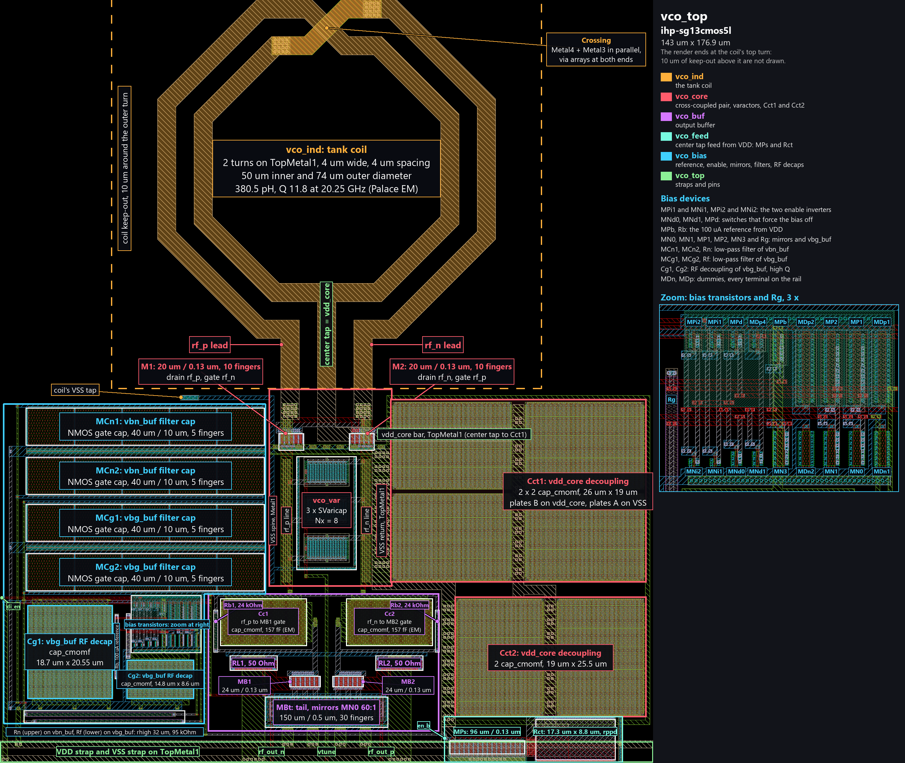

# ihp-sg13cmos5l VCO

<p align="center">
  <a href="render/vco_top_annotated.png">
    
  </a>
  <br>
  <em>Annotated render of the ihp-sg13cmos5l VCO layout (143um x 176.9um).</em>
</p>

A 20 GHz LC voltage-controlled oscillator built from CMOS devices only, the RF macro of this template. It is the starting point for RF blocks: next to the analog flow of the [inverter](../inverter/README.md) it carries layouts written by KLayout Python scripts, the EM simulation of the coil with AWS Palace, its lumped-element model from snp2le, the periodic steady-state, small-signal and noise analyses of VACASK, transient noise, and a post-layout simulation with the EM model of the coil in place. The core follows a published design, the 27 GHz cross-coupled VCO of Jung and Park [[1]](#references), scaled to 20 GHz and to the devices of this PDK. It is the VCO of the ihp-sg13g2 template, ported to a process without TopMetal2, Metal5, MIM capacitors and an inductor PCell, see [Porting from ihp-sg13g2](#porting-from-ihp-sg13g2).

This is a simple VCO to learn the RF flow on, not an optimized design. It goes through each step once, and [Limitations](#limitations) lists where it falls short and what a better design would change. The chip top-level does not place it yet, see [Open Points](#open-points).

> [!IMPORTANT]
> The VACASK testbenches need the IIC-OSIC-TOOLS container with tag `2026.10` or later: the oscillator PSS (`oscillator=1`), `pac` and `pnoise` arrived in VACASK after the `2026.09` image.


## Specification

| Parameter | Target | Simulated (TT, 27 C) |
| --- | --- | --- |
| Oscillation frequency | 20 GHz | 20.09 GHz post-layout at `vtune` = 0.75 V, 22.75 GHz in the schematic |
| Tuning range | about 2 GHz, with 20 GHz inside it at every corner | 1.94 GHz post-layout, 19.40 GHz to 21.35 GHz for `vtune` from 0 V to 1.5 V, 2.62 GHz in the schematic (21.77 GHz to 24.38 GHz) |
| Tuning gain | | 0.49 GHz/V to 1.78 GHz/V post-layout (1.59 GHz/V at 0.75 V), 0.77 GHz/V to 2.24 GHz/V in the schematic (2.01 GHz/V at 0.75 V) |
| Phase noise | not optimized, reported | -101.6 dBc/Hz at 1 MHz post-layout (transient noise), -101.3 dBc/Hz in the schematic (PNOISE), see [Phase Noise](#phase-noise) |
| Output power | -10 dBm or more per output into 50 Ohm | -8.3 dBm in the schematic (PSS), -10.2 dBm post-layout from the peak-to-peak swing, which counts the harmonics and reads up to about 1 dB high |
| Supply | `VDD` = 1.5 V from a quiet pad of its own, see [Limitations](#limitations) | 10.8 mA post-layout: core 4.6 mA, buffer tail 5.9 mA, the rest the bias |
| Bias | from `VDD`, no reference input: `MPb` and `Rb` set about 100 uA in `MN0` | |
| Power down | `di_en` low stops the core, the buffer and the bias | no oscillation and 9 nA from `VDD` post-layout, see [Power-Up and Enable](#power-up-and-enable) |
| Start-up | from any order of `VDD` and `di_en` | post-layout, the tank is up 4.2 ns after `VDD` and `di_en`, the output settles within 4.8 us |
| Corners | starts and stays below 1.5 V on every node at SS, TT and FF, -40 C to 85 C, with the resistor corners and `VDD` from 1.35 V to 1.65 V | yes post-layout, 19.07 GHz to 21.59 GHz, highest node 1.495 V, see [Corners](#corners) |

The macro is centered on its post-layout simulation (see [Post-Layout Simulation](#post-layout-simulation)): 20 GHz at the middle of the tuning range, and `Rct` where every post-layout corner starts at the weak end, `res_wcs` with `VDD` at 1.35 V, and no tank node passes 1.5 V at the strong end, `res_bcs` with `VDD` at 1.65 V. The schematic, without the resistance and the capacitance of the leads, oscillates 13 % higher and swings higher, so its tank peaks pass 1.5 V at FF, and they are reported but not checked. The coil model in every simulation is fitted to the EM simulation of the coil's layout (see [EM Simulation of the Coil](#em-simulation-of-the-coil)).


## Circuit

| Cell | Function |
| --- | --- |
| `vco_top` | the macro: bias, tap feed, core, coil, buffer and the pins |
| `vco_core` | negative resistance and tank capacitance: the cross-coupled NMOS pair `M1`/`M2`, the varactor array, and the decoupling capacitors `Cct1` and `Cct2` of `vdd_core` at the coil's center tap |
| `vco_ind` | the center-tapped tank coil: the inductor the LVS deck extracts (`vco_ind_lvs.sym`), and the lumped-element model `vco_ind_le` for simulation |
| `vco_var` | the varactor array: three `sg13_hv_svaricap` with `Nx=8` each, gates on the tank, wells on `vtune` |
| `vco_buf` | AC-coupled differential output buffer with 50 Ohm back-termination |
| `vco_feed` | the center tap's feed from `VDD`: the switch `MPs` and the resistor `Rct` |
| `vco_bias` | the reference `MPb` and `Rb`, the enable logic, the two bias voltages of the buffer, each behind an RC low-pass filter, and the RF decoupling of `vbg_buf` |

**Core.** The core is the voltage-biased cross-coupled pair of Jung and Park [[1]](#references): two NMOS (20 um / 0.13 um each) with their sources on `VSS`, and no current source at all. The center tap of the coil, the net `vdd_core`, hangs on `Rct` (17.3 um by 8.8 um of `rppd`) and the switch `MPs` from `VDD`, about 160 Ohm together with the leads, so the tap finds its own voltage: 0.76 V post-layout, against 0.639 V in the paper. The tank's common mode is then that voltage, and the pair draws whatever current its gate-source voltage gives: 4.6 mA at TT, 4.2 mA to 5.0 mA over the post-layout MOS corners. A slow corner draws less, so the tap rises and gives the pair more gate voltage, a fast corner the other way round. That common mode is what the varactor needs. `sg13_hv_svaricap` is an accumulation-mode MOS varactor whose capacitance changes most around 0 V gate-to-well voltage, so with the gates on the tank and the wells on `vtune`, a tune voltage from 0 V to `VDD` sweeps it across that transition. Each tank node swings from about 0.26 V to 1.24 V post-layout: the core works in the voltage-limited regime of Hajimiri and Lee [[2]](#references), where the supply and not a current sets the amplitude. So `VDD` and the spread of `Rct` set the amplitude, and `Rct` sits where the weak end of both still starts and the strong end stays below 1.5 V, see [Corners](#corners). `Cct1` and `Cct2` decouple `vdd_core` at the center tap, where the pair's current pulses at twice the oscillation frequency. They are six `cap_cmomf` units on Metal1 to Metal4, 3.8 pF by the model and 3.7 pF in the extraction.

**Why a resistor feeds the tap.** A PMOS current source on the tap, which sets the common mode by the pair's gate-source voltage at a fixed current, lets the bias noise move the varactor's operating point: the first version of this macro, in the ihp-sg13g2 template, had -85.4 dBc/Hz at 1 MHz, 92 % of it from the bias chain. A fixed voltage on the tap from a pad of its own removes that path but needs the pad. A PMOS mirror from `VDD` brings its noise back, -98.3 dBc/Hz at 1 MHz behind a 190 kOhm and 10 pF filter and -88.8 dBc/Hz without one, against -101.3 dBc/Hz with `Rct`, in the schematic of the ihp-sg13g2 macro. The resistor keeps the macro on `VDD` alone and costs a defined current and the rejection of `VDD`, see [Limitations](#limitations).

**Coil.** The tank coil is a symmetric octagon of 2 turns in TopMetal1 with a center tap, 4 um width, 4 um spacing, 50 um inner and 74 um outer diameter, in a keep-out 10 um wide around it. This PDK has neither TopMetal2 nor an inductor PCell, so [`vco_ind.py`](scripts/layout/vco_ind.py) draws it, with its one crossing on Metal4 and Metal3 in parallel. Its EM simulation gives 380.5 pH differential with a Q of 11.8 at 20.25 GHz, see [EM Simulation of the Coil](#em-simulation-of-the-coil). Its diameter and the length of its leads set the post-layout frequency, see [Post-Layout Simulation](#post-layout-simulation). The PDK has no SPICE model for the coil, so `vco_ind` holds two views of it. The LVS view `vco_ind_lvs.sym` is what KLayout LVS extracts, and every simulation netlist skips it (`spice_ignore` is a `tcleval` of the LVS switch, `spectre_ignore=true`). The lumped-element model `vco_ind_le` is what simulation uses, and the LVS netlist skips it (`lvs_ignore=open`). It is fitted with `make snp2le` to the EM result. Its substrate network returns to the global ground node, so `VSS` has to be the ground of every testbench. The deck extracts the coil in the top cell of every LVS run, because its third terminal is the substrate, so the coil sits in `vco_top` beside the core, in the schematic as in the layout.

**Varactor.** One `sg13_hv_svaricap` with `Nx=8` measures 31 fF to 21 fF differential (63 fF to 41 fF per tank node) for a gate-to-well voltage from +0.75 V to -0.75 V, with a differential Q of 23 to 30 at 20 GHz. The model is that of ihp-sg13g2. The layout differs: this PDK's `SVaricap` PCell draws ThickGateOx where the ihp-sg13g2 one draws nBuLay, which this process does not have. The well resistance of the model is about 200 Ohm per varactor. It only carries common-mode current and does not load the differential tank, but its thermal noise reaches the frequency through the tuning gain like noise on `vtune` does.

**Buffer.** A differential pair (24 um / 0.13 um each, 6 mA tail in 30 fingers of 5 um) is AC-coupled to the tank through `cap_cmomf` capacitors (Metal2 to Metal4, 10 um by 18.6 um, 170 fF by the model and 157 fF by EM) and biased at `vbg_buf` (about 1.04 V) through 24 kOhm resistors. Each output has a 50 Ohm `rppd` resistor to `VDD`, so the buffer is back-terminated for a 50 Ohm measurement setup, and the load has to be AC-coupled. The pair is as wide as it is for the output power: in the ihp-sg13g2 macro, 16 um would raise the frequency by 270 MHz and cost 1 dB.

**Bias and enable.** `MPb` and `Rb` (0.5 um by 13.1 um of `rppd`) feed the diode-connected NMOS `MN0` from `VDD` with about 100 uA, and `MBt` in the buffer mirrors it 60:1. `MN1` copies it into the diode-connected PMOS `MP1`, and `MP2` mirrors that into `Rg` and the diode `MN3`, which sets `vbg_buf` to a gate-source voltage plus 0.45 V. Both bias voltages pass an RC low-pass filter at about 170 kHz: `Rn` (95 kOhm) with `MCn1`/`MCn2` (9.4 pF) on `vbn_buf`, `Rf` (95 kOhm) with `MCg1`/`MCg2` (10 pF) on `vbg_buf`. They are there because the buffer's bias moves the frequency: the buffer's input capacitance depends on its currents and loads the tank through the coupling capacitors, by -38 MHz per mA of tail current in the ihp-sg13g2 macro. With the filters of the first version there (48 kOhm, 1.35 pF), that path set the phase noise once the core was quiet: -96.6 dBc/Hz at 1 MHz, with 77 % from `Rn` and `MN0`. The filter capacitors are NMOS gates (source, drain and bulk on `VSS`), 12 fF/um2 at these voltages against 1.29 fF/um2 for the densest `cap_cmomf` (Metal1 to Metal4), so 10 pF takes 800 um2. Their gate leakage drops 13 mV across `Rf`. `di_en` passes two inverters. Low, it opens `MPs` and `MPb` and pulls the NMOS gate lines to `VSS` and the PMOS gate line to `VDD`, so the core, the buffer and the bias stop. `MCg1` and `MCg2` have L = 10 um, so their channel resistance limits them at RF: `Cg1` and `Cg2` (`cap_cmomf`, about 0.7 pF) hold `vbg_buf` there. `vbn_buf` needs no such cap, as it ends on the gate of `MBt`, about 0.8 pF at L = 0.5 um.


## Pins

| Pin | Direction | Function |
| --- | --- | --- |
| `VDD` | inout | the macro's only supply, 1.5 V, about 10.8 mA. Feed it from a quiet pad of its own, not from the digital rail, see [Limitations](#limitations) |
| `VSS` | inout | ground |
| `di_en` | input | enable of the core, the buffer and the bias, active high |
| `vtune` | input | tuning voltage, 0 V to `VDD` |
| `rf_out_p`, `rf_out_n` | inout | differential RF output, 50 Ohm back-terminated to `VDD`, the load has to be AC-coupled |

In the layout (143 um by 176.9 um), `di_en` leaves on Metal3 at the left edge. `vtune`, `rf_out_n` and `rf_out_p` leave on Metal3 at the bottom edge. `VDD` and `VSS` are two TopMetal1 straps along the bottom edge, `VDD` the lower one, with their pins at the left end.


## Simulation Results

All results are from the testbenches in [`testbenches/xschem/`](testbenches/xschem/), plotted by `make sim-view-xschem` into [`testbenches/xschem/plot_simulations/figures/`](testbenches/xschem/plot_simulations/figures/). They were simulated in the IIC-OSIC-TOOLS nightly of 2026-11-02 (VACASK `d7b4db4`, ngspice 47, KLayout 0.30.12).

| Testbench | Simulator | Analyses | Result |
| --- | --- | --- | --- |
| `vco_top_tb_tran` | ngspice | start-up transient, 2 ns | 22.71 GHz, tank 0.11 V to 1.52 V, 272 mVpp per output (-7.3 dBm), `VDD` 11.6 mA, tap 0.78 V |
| `vco_top_tb_pss_vacask` | VACASK | oscillator PSS, PNOISE, PAC | 22.75 GHz, -8.3 dBm per output at the fundamental, -101.3 dBc/Hz at 1 MHz, K_VCO 2.06 GHz/V at 10 MHz (PAC) |
| `vco_top_tb_tune_vacask` | VACASK | one 1.5 ns transient per tuning voltage, on the schematic | 21.77 GHz to 24.38 GHz for `vtune` from 0 V to 1.5 V |
| `vco_top_tb_tran_lpe` | ngspice | start-up transient of the post-layout netlist | 20.09 GHz, tank 0.26 V to 1.24 V, `VDD` 10.8 mA, see [Post-Layout Simulation](#post-layout-simulation) |
| `vco_top_tb_tran_lpe`, by `make sim-tune-lpe` | ngspice | the post-layout transient at seven tuning voltages, at TT, 27 C | 19.40 GHz to 21.35 GHz for `vtune` from 0 V to 1.5 V, 20 GHz at `vtune` = 0.69 V, see [Tuning Curve](#tuning-curve) |
| `vco_top_tb_powerup_lpe` | ngspice | 44 post-layout transients from a supply ramp, over the orders of `VDD` and `di_en` | 44 of 44 runs ok: every order starts, no tank node above 1.33 V, nothing oscillates while disabled, see [Power-Up and Enable](#power-up-and-enable) |
| `vco_top_tb_trannoise_vacask` | VACASK | transient noise of the schematic, 8 seeds | -100.5 dBc/Hz at 1 MHz, against -101.3 dBc/Hz from PNOISE, see [Phase Noise](#phase-noise) |
| `vco_top_tb_trannoise_lpe_vacask` | VACASK | transient noise of the post-layout netlist, 8 seeds | -101.6 dBc/Hz at 1 MHz |
| `vco_ind_tb_acsp_vacask` | VACASK | ACSP, S-parameters of the coil model from 0 Hz to 60 GHz | 386.5 pH and Q 11.7 at 20.25 GHz, against 380.5 pH and Q 11.8 from EM |

The ngspice transient and the VACASK PSS agree on the oscillation frequency within 0.2 % (the VACASK tuning transient within 0.1 %), and the tuning gain from PAC agrees with the slope of the tuning curve within about 2 %.


### Tuning Curve

The macro is centered on the post-layout frequencies. The schematic has no leads, so it runs about 13 % higher and does not reach 20 GHz. Post-layout from `make sim-tune-lpe` (ngspice), schematic from `vco_top_tb_tune_vacask` (VACASK), both at TT, 27 C, `res_typ` and `VDD` = 1.5 V:

| `vtune` | Frequency, post-layout | `K_VCO`, post-layout | Frequency, schematic |
| --- | --- | --- | --- |
| 0 V | 19.40 GHz | 0.49 GHz/V | 21.77 GHz |
| 0.25 V | 19.53 GHz | 0.67 GHz/V | 21.96 GHz |
| 0.5 V | 19.74 GHz | 1.12 GHz/V | 22.28 GHz |
| 0.75 V | 20.09 GHz | 1.59 GHz/V | 22.74 GHz |
| 1 V | 20.54 GHz | 1.78 GHz/V | 23.28 GHz |
| 1.25 V | 20.98 GHz | 1.63 GHz/V | 23.86 GHz |
| 1.5 V | 21.35 GHz | 1.47 GHz/V | 24.38 GHz |

20 GHz is at `vtune` = 0.69 V. It stays inside the post-layout tuning range at all 81 combinations of MOS corner, temperature, resistor corner and `VDD`, with at least 0.33 GHz of room towards the low end and 1.02 GHz towards the high end. The coil model's inductance is about 2 % above the EM result, so the real frequency should sit about 0.2 GHz higher, which takes that much off the room at the low end.


### Corners

`make sim-corners` runs the start-up transient at the MOS corners SS, TT and FF (the LV and the HV models alike), at -40 C, 27 C and 85 C and at both ends of the tuning range, for every resistor corner and supply given. Since `Rct` and `Rb` set the currents, their spread and the supply's count together: the weak end is `res_wcs` with `VDD` at 1.35 V, the strong end `res_bcs` with `VDD` at 1.65 V. Post-layout, from [`vco_top_tb_tran_lpe_corners.csv`](testbenches/xschem/plot_simulations/figures/vco_top_tb_tran_lpe_corners.csv), 18 runs per row:

| Resistors, `VDD` | Frequency | Center tap | `VDD` current | Highest node | Lowest output |
| --- | --- | --- | --- | --- | --- |
| `res_typ`, 1.5 V | 19.12 GHz to 21.46 GHz | 0.73 V to 0.81 V | 9.6 mA to 11.9 mA | 1.33 V | -12.5 dBm |
| `res_wcs`, 1.35 V | 19.16 GHz to 21.59 GHz | 0.68 V to 0.78 V | 7.1 mA to 9.1 mA | 1.18 V | -16.0 dBm |
| `res_bcs`, 1.65 V | 19.07 GHz to 21.31 GHz | 0.79 V to 0.86 V | 12.4 mA to 15.2 mA | 1.49 V | -10.3 dBm |

Every one of the 162 post-layout runs starts, all nine combinations of the three resistor corners and the three supplies included, and the tuning range covers 20 GHz at every corner, 19.07 GHz to 21.59 GHz in all. The table shows the three cases that bound the macro. The highest node, 1.495 V, is at SS, -40 C, `vtune` 1.5 V with `res_bcs` and `VDD` at 1.65 V, the lowest output, -16.0 dBm, at SS, 85 C, `vtune` 0 V with `res_wcs` and `VDD` at 1.35 V. The output columns are read from the peak-to-peak swing (see [Post-Layout Simulation](#post-layout-simulation)). Schematic, from [`vco_top_tb_tran_corners.csv`](testbenches/xschem/plot_simulations/figures/vco_top_tb_tran_corners.csv):

| Resistors, `VDD` | Frequency | Center tap | `VDD` current | Highest node | Lowest output |
| --- | --- | --- | --- | --- | --- |
| `res_typ`, 1.5 V | 21.36 GHz to 24.53 GHz | 0.75 V to 0.81 V | 10.5 mA to 12.7 mA | 1.63 V | -8.8 dBm |
| `res_wcs`, 1.35 V | 21.41 GHz to 24.78 GHz | 0.68 V to 0.74 V | 8.0 mA to 9.7 mA | 1.45 V | -10.7 dBm |
| `res_bcs`, 1.65 V | 21.31 GHz to 24.27 GHz | 0.82 V to 0.89 V | 13.3 mA to 16.3 mA | 1.82 V | -7.2 dBm |

Without the leads, the schematic's tank swings higher, up to 1.82 V. The macro is centered on the post-layout corners, so `sim-corners` fails on a tank node above 1.5 V only on the post-layout testbench (`VPEAK_MAX`).


### Power-Up and Enable

`make sim-powerup` runs the post-layout macro from zero, over six orders of `VDD` and `di_en` (see [Power-Up and Enable Transient](#power-up-and-enable-transient)), from [`vco_top_tb_powerup_lpe_corners.csv`](testbenches/xschem/plot_simulations/figures/vco_top_tb_powerup_lpe_corners.csv):

| Sequence | Runs | Result | Tank up after | Highest node |
| --- | --- | --- | --- | --- |
| `VDD` first, `di_en` up at 100 ns and down at 8.1 us | 5 | 5 ok | 7.2 ns at most | 1.334 V |
| `di_en` low | 19 | 19 without oscillation, tank swing below 1 nV, at most 0.6 uA from `VDD` | | |
| `di_en` tied to `VDD`, 10 ns ramp | 5 | 5 ok | 4.3 ns at most | 1.321 V |
| `di_en` tied to `VDD`, 1 ns ramp | 5 | 5 ok | 5.5 ns at most | 1.332 V |
| `di_en` before `VDD` | 5 | 5 ok | 4.3 ns at most | 1.319 V |
| `di_en` 300 ns after `VDD` | 5 | 5 ok | 4.1 ns at most | 1.335 V |

Every run passes. With `di_en` rising at 100 ns, the tank is up after 4.2 ns at TT, 27 C, and after 7.2 ns at the slowest corner. The output takes longer: the bias filters of the buffer (170 kHz) set its current, so the output reaches 99 % of its final swing after 4.8 us at TT and 5.6 us at worst, and the frequency comes within 10 MHz of its final value after 3.6 us. When `di_en` falls, the output drops below 10 % within 3 ns, and the macro draws 9 nA from `VDD` at TT, 27 C with `di_en` low.


### Phase Noise

| Offset | PNOISE, schematic | Transient noise, schematic | Transient noise, post-layout |
| --- | --- | --- | --- |
| 1 MHz | -101.3 dBc/Hz | -100.5 dBc/Hz | -101.6 dBc/Hz |
| 3 MHz | -113.5 dBc/Hz | -112.0 dBc/Hz | -113.9 dBc/Hz |
| 10 MHz | -124.7 dBc/Hz | -124.5 dBc/Hz | -123.8 dBc/Hz |
| 30 MHz | -134.5 dBc/Hz | -135.2 dBc/Hz | -133.9 dBc/Hz |
| 100 MHz | -145.1 dBc/Hz | -145.3 dBc/Hz | -144.4 dBc/Hz |

`make sim-trannoise` checks PNOISE with an analysis that shares no code with it: on the schematic, transient noise over 8 seeds and PNOISE differ by -0.7 dB to +1.5 dB from 1 MHz to 100 MHz, with a scatter of the seeds of about 0.6 dB at 1 MHz. At 1 MHz the post-layout phase noise is 1.1 dB below the schematic's: about 1 dB of that is the lower carrier, and the rest is within the scatter of the seeds.

The phase noise at 1 MHz offset in PNOISE comes 56 % from the core (pair 40 %, varactors 9 %, coil 7 %) and 34 % from `vco_bias`, most of it from the buffer's tail bias (`Rn` 27 %, `MN0` 4 %), the rest from the buffer's devices. Below 1 MHz the tail bias takes over: its noise passes the 170 kHz low-pass of the bias filters, so its share grows by 40 dB to 48 dB per decade towards lower offsets, against 20 dB for the core. Post-layout, with 6.9 mW in the core (1.5 V times 4.6 mA), the phase noise from transient noise gives a figure of merit of -179.2 dBc/Hz.


## Directory Structure

<details>
<summary>Show Directory Structure</summary>

```text
📁 vco/
├─ 📁 final/
│  ├─ 📁 gds/
│  │  └─ vco_top.gds
│  ├─ 📁 lef/
│  │  └─ vco_top.lef
│  ├─ 📁 lib/
│  │  └─ vco_top.lib
│  └─ 📁 vh/
│     └─ vco_top.vh
├─ 📁 layout/
│  ├─ vco_bias.gds
│  ├─ vco_buf.gds
│  ├─ vco_core.gds
│  ├─ vco_feed.gds
│  ├─ vco_ind.gds
│  ├─ vco_top.gds
│  └─ vco_var.gds
├─ 📁 netlist/
│  ├─ 📁 layout/
│  │  ├─ *_klayout.cir
│  │  └─ *_magic.ext.spc
│  ├─ 📁 pex/
│  │  ├─ *_magic_pex_3.spice
│  │  └─ vco_top_leads_klayout_pex_3.spice
│  ├─ 📁 schematic/
│  │  ├─ *_klayout.cdl
│  │  └─ *_magic.spice
│  ├─ 📁 spectre/
│  │  ├─ vco_ind_le.inc
│  │  └─ vco_top_leads.inc
│  └─ 📁 spice/
│     └─ vco_ind_le.spice
├─ 📁 render/
│  ├─ 📁 img/
│  │  ├─ vco_top_black.png
│  │  └─ vco_top_white.png
│  └─ vco_top_annotated.png
├─ 📁 schematic/
│  └─ 📁 xschem/
│     ├─ vco_bias.sch
│     ├─ vco_bias.sym
│     ├─ vco_buf.sch
│     ├─ vco_buf.sym
│     ├─ vco_core.sch
│     ├─ vco_core.sym
│     ├─ vco_feed.sch
│     ├─ vco_feed.sym
│     ├─ vco_ind.sch
│     ├─ vco_ind.sym
│     ├─ vco_ind_le.sym
│     ├─ vco_ind_lvs.sym
│     ├─ vco_top.sch
│     ├─ vco_top.sym
│     ├─ vco_var.sch
│     ├─ vco_var.sym
│     ├─ *_pex.sym
│     └─ xschemrc
├─ 📁 scripts/
│  ├─ 📁 layout/
│  │  ├─ vco_bias.py
│  │  ├─ vco_buf.py
│  │  ├─ vco_core.py
│  │  ├─ vco_feed.py
│  │  ├─ vco_ind.py
│  │  ├─ vco_layout.py
│  │  ├─ vco_top.py
│  │  └─ vco_var.py
│  ├─ check_boundary.py
│  ├─ check_coil_tap.py
│  ├─ check_drc_regular.py
│  ├─ check_mom.py
│  ├─ check_pex_ports.py
│  ├─ check_trannoise.py
│  ├─ drop_subcells.py
│  ├─ momf_lpe.py
│  ├─ netgen_setup.tcl
│  ├─ pex_caps.py
│  ├─ sim_corners.py
│  ├─ sim_powerup.py
│  ├─ sim_trannoise.py
│  ├─ spice2spectre.py
│  └─ tie_pex_substrate.py
├─ 📁 testbenches/
│  └─ 📁 xschem/
│     ├─ 📁 models/
│     │  ├─ cornerMOShv.lib
│     │  ├─ sg13g2_svaricaphv_mod.lib
│     │  └─ sg13g2_svaricaphv_mod_mismatch.lib
│     ├─ 📁 plot_simulations/
│     │  ├─ 📁 data/
│     │  ├─ 📁 figures/
│     │  ├─ ngspice2python.py
│     │  ├─ plot_vco_ind.py
│     │  ├─ plot_vco_top.py
│     │  └─ vacask2data.py
│     ├─ vco_ind_tb_acsp_vacask.sch
│     ├─ vco_top_leads.sym
│     ├─ vco_top_lpe.sch
│     ├─ vco_top_lpe.sym
│     ├─ vco_top_tb_powerup_lpe.sch
│     ├─ vco_top_tb_pss_vacask.sch
│     ├─ vco_top_tb_tran.sch
│     ├─ vco_top_tb_tran_lpe.sch
│     ├─ vco_top_tb_trannoise_lpe_vacask.sch
│     ├─ vco_top_tb_trannoise_vacask.sch
│     ├─ vco_top_tb_tune_vacask.sch
│     └─ xschemrc
├─ 📁 verification/
│  ├─ 📁 drc/
│  ├─ 📁 em/
│  │  ├─ 📁 layout/
│  │  │  ├─ momf_w10_l18p6_m24_dut.gds
│  │  │  ├─ momf_w10_l18p6_m24_open.gds
│  │  │  ├─ momf_w10_l18p6_m24_short.gds
│  │  │  └─ vco_ind.gds
│  │  ├─ 📁 palace_model/
│  │  │  ├─ 📁 momf_w10_l18p6_m24_dut_data/
│  │  │  ├─ 📁 momf_w10_l18p6_m24_open_data/
│  │  │  ├─ 📁 momf_w10_l18p6_m24_short_data/
│  │  │  └─ 📁 vco_ind_data/
│  │  ├─ 📁 s-parameter/
│  │  │  └─ vco_ind.s3p
│  │  ├─ 📁 scripts/
│  │  │  ├─ momf_parasitics.py
│  │  │  ├─ palace_momf.py
│  │  │  └─ palace_vco_ind.py
│  │  └─ cap_cmomf_parasitics.json
│  └─ 📁 lvs/
├─ Makefile
└─ README.md
```

</details>

The folders are those of the [inverter](../inverter/README.md#directory-structure), with three differences. `layout/<cell>.gds` is written by `scripts/layout/<cell>.py` and not exported from a `.klay.gds` drawn by hand. `verification/em/` holds the EM simulations of the coil and of the buffer's coupling caps, and `netlist/spice/` and `netlist/spectre/` the coil's lumped-element model for ngspice and VACASK. And `render/vco_top_annotated.png` is the figure above, drawn over a render by hand: `make render-gds` rewrites `render/img/` only.


## Makefile Targets

### Show Available Targets

The default Make target is `help`, so running `make` prints usage and all available targets with short descriptions.

```sh
make
make help
```

All targets that operate on a specific cell accept an optional `CELL=<cellname>` parameter. The default is the top-level cell (`vco_top`).


### PDK Guard

Every target except `help` and `clean` needs the `ihp-sg13cmos5l` PDK and stops at parse time when `$PDK` differs, exactly as in the [inverter](../inverter/README.md#pdk-guard). Switch the PDK with `sak-pdk ihp-sg13cmos5l`.


### Open the Design Files

```sh
make open
make open OPEN_ARGS=--all
```

Opens the design files of this folder in the `sak-open.py` file browser, see [Open the Design Files](../inverter/README.md#open-the-design-files) in the inverter.


### Generate the Layouts with KLayout Python Scripts

```sh
make klayout-script CELL=vco_bias     # one cell
make klayout-script-all               # every cell, subcells before the cells that place them
```

Every layout of this macro is written by a KLayout Python script in [`scripts/layout/`](scripts/layout/), run in batch mode, which writes `layout/<CELL>.gds`. Nothing is drawn by hand: to change a layout, change its script, rerun it, and rerun DRC and LVS.

| Script | Cell | Floorplan |
| --- | --- | --- |
| [`vco_ind.py`](scripts/layout/vco_ind.py) | the coil | drawn without a PCell: two octagonal turns of TopMetal1, the crossing on Metal4 and Metal3 with via arrays at both ends, the leads and the center tap down to the lower edge of the keep-out 10 um below the outer turn, the `IND` box with its pins and labels and the no-fill markers, and a `ptap1` for the substrate terminal |
| [`vco_var.py`](scripts/layout/vco_var.py) | the varactor array | three `SVaricap` stacked in a column, each one's bottom gate strip on a Metal2 stub to the `rf_p` bus on the left, its top strip on an equal stub to the `rf_n` bus on the right, both buses on Metal3 8 um off the axis where the core's tank lines run, `vtune` on Metal3 over the well contacts, a substrate tap on three sides |
| [`vco_bias.py`](scripts/layout/vco_bias.py) | bias and enable | the four NMOS gate capacitors on top as two mirrored row pairs that share their tap band. Below them a rectangle: the NMOS and PMOS rows in its top right corner, next to the buffer's bias pins, sharing their columns and facing each other with their gates, the mirrors closest to `MBt` between end dummies, `Rg` beside the rows, `Cg1` and `Cg2` as an L around them, `Rn` and `Rf` along the bottom. Metal2 stubs reach Metal3 tracks over the rows at a 0.51 um pitch. The lines that pass the decaps run in a band of Metal3 tracks above them, with `VDD` on Metal1 under that band and `VSS` on Metal1 below the decaps and up a lane between them |
| [`vco_buf.py`](scripts/layout/vco_buf.py) | the output buffer | mirror-symmetric: the tail (30 fingers) at the bottom, its taps also biasing the pair's substrate, the pair above it, the 50 Ohm loads at the sides, the coupling caps on top, each with its plate B fed from above as the input and its plate A facing inward to the gate line, the gate bias resistors outside them |
| [`vco_core.py`](scripts/layout/vco_core.py) | the core | the varactor array as a subcell, a column under the coil's feeds: `rf_p` and `rf_n` as Metal3 lines 2.5 um wide down its whole height, doubled on Metal4 except where the pair's `VSS` bar crosses them, from 6 x 6 via stacks at the feeds, the pair right below the feeds with its cross-coupling on Metal2 (`rf_n`) and Metal3 (`rf_p`) from via rows along its gate pads, the array below it with its buses on the same lines. The center tap's TopMetal1 spine turns right into the middle collector of `Cct1`, which fills the space right of the column, `Cct2` the space right of the buffer. In each array the columns are mirrored in pairs, so the plates on `vdd_core` share one collector in the middle, under a TopMetal1 strap, and the plates on `VSS` face outward. The pair's source bar returns to `VSS` on TopMetal1, down the channel between the column and `Cct1` |
| [`vco_feed.py`](scripts/layout/vco_feed.py) | the tap feed | on the macro's bottom edge: the switch `MPs` with its source rail along the bottom, under the `VDD` strap, then `Rct` with the coil's side at the bottom, then the substrate tap. Metal2 over `Rct` takes the current from the drain to the top head, Metal3 from the bottom head to the macro's line up to the coil |
| [`vco_top.py`](scripts/layout/vco_top.py) | the macro | as wide as the coil's keep-out: the coil at the core's origin, the core's column on the axis, the buffer centered under it, the bias on the left, the tap feed under `Cct2`, two TopMetal1 straps along the bottom with VDD below VSS, the tap on a TopMetal1 tab with 32 Via3 cuts down to Metal3 and the tap feed, nothing that closes a loop around the coil, the PR boundary with the origin at its lower-left corner |

The macro measures 143 um by 176.9 um, 35 % of it the coil's keep-out, and every region outside it is filled: the bias's capacitor rows beside the core's column, `Cct1` and `Cct2` on the other side. The scripts share [`vco_layout.py`](scripts/layout/vco_layout.py):

- `mos()` builds a transistor with its wiring: a poly strap with contacts joining the gate fingers below the active area and a Metal1 pad reaching 1 um past the device's left edge, the sources up to a Metal1 rail, the drains joined by a Metal2 strap through the middle, and a substrate or well tap under the source rail or apart from it. With `cap=True` it builds a MOS capacitor, every stripe on the rail. The cell scripts place it mirrored or rotated.
- `stub()` and `track()` join a port to a horizontal track, the routing scheme of the bias cell. The bias script checks its stubs for two nets that would touch before it writes anything.
- `comb_feed()` connects one plate of a `cap_cmomf`, see below.
- Every coordinate snaps to the 5 nm grid. A cell is written flat except for the subcells it places (the core keeps the varactor array, the macro keeps bias, core, coil and buffer), so LVS compares the hierarchy of the schematic and cells read from several files cannot clash by name. Each metal is merged into one polygon per connected piece, so no internal outline reads as broken metal.
- Pins are a pin shape (datatype 2) with its label (datatype 25), as in the inverter.

What the scripts had to learn:

- **A KLayout batch script that ends in `SystemExit` exits with code 0 and prints nothing**, so a failed check would leave the old GDS in place. The scripts raise `RuntimeError`, which KLayout reports and `make` stops on.
- **PDK PCells write their terminal names as texts**: `SVaricap` writes `G1`, `G2` and `W` on TEXT, and `ntap1` writes `well` on the NWell layer. KLayout LVS names a net after each of them, and a net with a second name fails its strict port check, while Magic, and so KPEX, turns the NWell text into a dangling port. The cells drop the texts once they are flat (`write(drop_texts=...)`).
- **A tap writes `sub!` at its center, and Magic gives that name to the topmost metal there.** A strap of another net over that point makes the full-RC extraction name its net `VSS` while KLayout LVS stays clean, as it did on the ihp-sg13g2 macro. [`pex_caps.py`](scripts/pex_caps.py) stops on the capacitance it cannot match to a net. `Cg2`'s Metal4 tab keeps clear of the point.
- **The bias's `VSS` path sets the tail current.** `MBt` mirrors `MN0`, so the potential of `MN0`'s source moves the tail. A Metal4 lane with via stacks to the rows, by estimate about 30 Ohm under their 0.3 mA, raised the `VDD` current by 0.15 mA and lowered the frequency by 4 MHz. The lane is on Metal1 now and the rail below the decaps is 1.75 um wide.
- **The resistor PCells compute a dimension from R by default** (`Calculate`), so the scripts pass `Calculate="R"` to keep the drawn width and length.
- **The buffer's tail is drawn as one device with 30 fingers.** KLayout LVS does not combine parallel devices (`m`) with a multi-finger device, so the schematic says `w=150u ng=30`.
- **Two `ptap1` taps that abut put their contact rows 0.1 um apart**, which fails `Cnt.b`. The capacitor rows' taps keep 0.3 um between them, and one Metal1 band covers both.
- **The pair's ground path is part of the circuit.** On Metal4 alone, the path from the pair's source bar around `Cct1` and `Cct2` to the `VSS` pin was 16 Ohm in the post-layout netlist, which put the sources 64 mV above `VSS` at 4 mA. A TopMetal1 return down the free channel beside the column, along under `Cct1` and down `Cct2`'s outer collector, and a TopMetal1 strap of 4 um along the macro's bottom edge brought it to 1.9 Ohm from the pin to the sources.
- **At 20 GHz the leads are part of the tank.** The coil's own series resistance is 2.05 Ohm per side, and with every resistance extracted (see [Parasitic Extraction (PEX)](#parasitic-extraction-pex)) the first layout had 41 Ohm and 23 Ohm in the pair's gate lines, one via of 9 Ohm per level, 3.5 Ohm from the coil's feed to the varactors over 1 um of Metal3, and 3.8 Ohm in the supply path of `vdd_core` through four Via3 cuts. That VCO did not start at the slow corner. Via rows along the gate pads, the tank lines at 2.5 um and doubled on Metal4, 6 x 6 via stacks at the feeds and 16 cuts under `vdd_core` brought the gate lines to 4.5 Ohm, the feed to the varactors to 1.4 Ohm and the pair's drains to 1.8 Ohm.
- **The buffer's gate lines are part of the tank too.** The tank drives the pair's gates through the coupling caps and these lines, so their resistance is tank loss. One Via1 cut and a 2 x 2 via stack gave 16.5 Ohm from the cap to the 12 gates, and the worst tank swing over the corners fell to 0.47 V at `vdd_core` = 0.78 V. Metal1 and Metal2 over the gate pad with two via rows along it and a 2 x 5 via stack bring it to 4.5 Ohm.
- **A line next to the first source stripe of a transistor can short a net that DRC cannot see.** The enable line `en_b` of `MPs` once touched the Metal2 over that stripe in the ihp-sg13g2 macro, a short to `VDD` that only LVS of `vco_top` found. The gate pad of `MPs` now reaches 1.5 um past the device (`gext`) in both macros, and the line lands on it there.

Four details of `cap_cmomf`, the only capacitor of this PDK besides the MOS gate:

- **Its plates are combs on every metal from `mmin` to `mmax`, and a wide conductor may not merge onto them.** Merged onto a comb, a wide feed turns the PCell's own 0.21 um gaps into a wide-metal spacing violation. `comb_feed()` feeds a plate through the edge band it owns, with bridges 0.35 um wide (under the 0.39 um wide-metal threshold) from a collector 0.3 um outside the cap. Plate A owns the west face and the south spine, plate B the east face and the north spine, so the face chooses the plate.
- **KLayout LVS orders its two terminals by the x position of their pins**, so a unit mirrored in x has its terminals swapped against one placed as drawn, and the deck does not combine the two. The schematic splits every array by orientation (`Cct1a` as drawn, `Cct1b` mirrored) so that each group combines on its own.
- **The deck compares neither `w` nor `l`, and `mmin` and `mmax` never reach the LVS netlist**, so a schematic at the wrong size or stack still matches, while the model's density runs from 0.61 fF/um2 to 1.29 fF/um2 over the stacks. [`check_mom.py`](scripts/check_mom.py) closes the gap: it compares the extent and the metals of every `cap_cmomf` marker of a cell with the instances of its schematic, and `make check-mom CELL=<cell>` runs it on the buffer and the core.
- **Magic draws it but extracts no device for it**, so Magic LVS of the buffer and the bias reruns Netgen with [`netgen_setup.tcl`](scripts/netgen_setup.tcl), the PDK setup plus `ignore class "-circuit2 cap_cmomf"`. The `sak-lvs.sh` run before it reports LVS errors for that reason and does not stop `make` for the cells in `MOM_CELLS`.

Three details of the coil:

- `d` is the inner diameter: 50 um gives the 74 um outer diameter. The `IND` box, the coil's keep-out, keeps 10 um around the outer turn, 94 um by 94 um, and the leads and the tap cross it to its lower edge: `LA` and `LB` at x = -8 um and 8 um, `LC` at x = 0, all on TopMetal1, their pins and labels 1 um below the box. The `inductor3` PCell of ihp-sg13g2 keeps 30 um, which made the leads 31 um long here, 24 pH of the coil's differential inductance and 40 um of the macro's height, and kept the pair and the varactors that far from the windings. The deck has no rule on the margin. The box also carries the no-fill markers `NoMetFiller` (160/0), `Activ.nofill` and `GatPoly.nofill`: a fill tile in the coil's field is a shorted turn, and the metal filler reads only the first of them.
- **KLayout LVS extracts the coil from its `IND` box as an `inductor` from `LA` to `LB`** with the substrate as third terminal, and with `w`, `s`, `d` and `nr_r` read from the drawn geometry, which [`vco_ind_lvs.sym`](schematic/xschem/vco_ind_lvs.sym) repeats. It puts the device into the top cell of the run, whatever cell holds the coil: with the coil inside the core, the core's own run found it there, but the macro's run moved it out of the core, so no one schematic hierarchy matched both. So `vco_top` places the coil beside the core, and the `ptap1` ties the substrate terminal to `VSS`.
- **No LVS sees the center tap.** Inside the `IND` box Metal3, Metal4 and TopMetal1 are device core and not conductors, so the tap ends at the box edge in every extracted netlist. [`check_coil_tap.py`](scripts/check_coil_tap.py) proves it on the GDS with plain connectivity: the winding is one net, the tap that crosses the box edge between the leads is on it, the substrate tap is not, a cut at x = 0 splits the coil into two halves with one half of the tap each, and the halves are mirror images in projection. `--self-test` plants a tap that is open, off center and on two shorted turns, and fails unless each is caught. `make check-coil-tap` runs it on `vco_ind` and with `--feed vdd_core` on `vco_top`, where `vdd_core` has to reach the coil through the tap and only through it.


### EM Simulation of the Coil

```sh
make sim-em                 # EM layout, Palace model, solve, Touchstone files
make copy-sparam            # copy the result to verification/em/s-parameter/vco_ind.s3p
make view-em-sim            # plot L, Q and the S-parameters, against the model once the ACSP testbench has run
make em-model               # sim-em, copy-sparam, snp2le and the ACSP testbench in one go
make sim-em NP=8            # more MPI processes
```

`sim-em` runs [`palace_vco_ind.py`](verification/em/scripts/palace_vco_ind.py), which builds two things from `layout/vco_ind.gds` with gds2palace:

- **The EM layout** `verification/em/layout/vco_ind.gds`: the coil metals (Metal3, Via3, Metal4, TopVia1, TopMetal1) and a Metal1 ground as in the inductor synthesis example of the PDK's Palace flow, a 20 um wide frame half a coil diameter away from the windings and a tongue from the frame up under the three feeds. The ports are 50 Ohm lumped ports, vertical sheets from the tongue up to TopMetal1 at the lower end of each feed pin: port 1 at `LA`, port 2 at `LB`, port 3 at the center tap `LC`, the port order of snp2le's `inductor-ct`. The script reads the coil's diameter and pins from the layout, so it follows a change of the coil.
- **The Palace model** in `verification/em/palace_model/vco_ind_data/`: the stackup `SG13CMOS5L_200um.xml` with its 200 um lossy substrate, a sweep from 0 Hz to 60 GHz in 0.75 GHz steps to cover the third harmonic (gds2palace replaces 0 Hz by 10 MHz and 20 MHz), Palace's adaptive frequency sweep, third-order elements, 3 um cells along the conductors and 2 um cells inside the coil metals. This PDK has no Palace flow of its own: the stackup and the scripts come from `libs.tech/palace` of ihp-sg13g2, which carries the SG13CMOS5L stackup, so the `Makefile` reads them from `$PDK_ROOT/ihp-sg13g2` (`PALACE_SCRIPTS`) and the script names the stackup's PDK (`STACKUP_PDK`).

Palace solves the model, and `combine_extend_snp.py` of the PDK writes `vco_ind.s3p` and three variants of it to `output/vco_ind/`: `_dc` with an extrapolated DC point, and `_deembedded` with the inductance of the vertical ports subtracted. `copy-sparam` takes the raw file, because the vertical port stands for the via stack down to the transistors, which the coil sees in the circuit as well.

**The metals are volumes.** gds2palace models a metal either as a hollow shell with a surface impedance (`surface`, its default) or as a solid with the bulk conductivity of the stackup (`volume`). The coil's traces are 4 um wide and 2 um thick, the case where the surface model is least accurate: it applies the surface impedance to the side walls as well and so counts them as extra cross-section. The study of the ihp-sg13g2 macro on its first coil showed it at 10 MHz: the surface model gave 1.65 Ohm, less than the 1.72 Ohm of the traces alone, and the volume model 2.93 Ohm. Two more settings came out of it:

- `fill_factor_correction`: gds2palace merges each via array into one block to keep the mesh small. Without the correction a block has the resistance of a solid via of its size, much less than that of its vias.
- Third-order elements, with 2 um cells inside the coil metals (Metal3, Metal4 and TopMetal1). Second-order elements with 1 um cells read the coil's Q 2.0 % lower at 20.25 GHz (0.7 % at 10 GHz, 3.4 % at 60 GHz) and its L 0.4 % lower, while halving those cells to 0.5 um moved Q by 1.6 % in that study: the element order, not the cell, limited the second-order result. The skin depth of TopMetal1 at 20 GHz is 0.68 um. Third order with 1 um cells did not fit into 15 GB of memory.

The committed coil gives 380.5 pH, 4.10 Ohm and Q 11.8 at 20.25 GHz, 2.56 Ohm at 10 MHz. The sweep took 2.9 hours with `NP=6` and 7.2 GB of memory, 20 minutes at second order. The EM layout, the Palace configuration, its outputs and the Touchstone file are committed. The mesh `vco_ind.msh` is not, `sim-em` rebuilds it in a few seconds.


### Lumped-Element Model of the Coil

Fits a lumped-element model to the S-parameters of a passive with [snp2le](https://github.com/iic-jku/snp2le) and writes it for both simulators, `netlist/spice/<EM>_le.spice` (ngspice) and `netlist/spectre/<EM>_le.inc` (VACASK). The `.SUBCKT` name is the file stem, which is also the name of the symbol that instantiates it (`vco_ind_le.sym`).

```sh
make snp2le                                   # fit verification/em/s-parameter/vco_ind.s3p
make snp2le SNP=<file.sNp>                    # fit another Touchstone file
make snp2le EM=<structure> SNP=<file.sNp> LE_MODEL=universal ORDER=8
```

- `EM` names the structure and the output files (default: `vco_ind`).
- `SNP` is the Touchstone file (default: `verification/em/s-parameter/<EM>.s3p`, written by `make copy-sparam`).
- `LE_MODEL` is an snp2le structure, `inductor-ct` for a center-tapped coil (default), `inductor-wideband` or `inductor-pi` for a two-port coil, or `universal` for a vector fit of order `ORDER` (default: 6).

The committed model is fitted with the defaults to the EM result of the drawn coil: two coil segments per half, peak differential Q 15.9 at 48.8 GHz against 16.4 at 51.0 GHz in the data. `make sim-xschem TB=vco_ind_tb_acsp_vacask` and `make view-em-sim` compare it with the EM data. From 1.5 GHz to 40 GHz the model is within 2.3 % of the EM inductance and within 4.3 % of its Q. At 20.25 GHz it is 1.6 % high in inductance (386.5 pH against 380.5 pH), which lowers the oscillation frequency by about 0.8 %, and 4.1 % low at 60 GHz.


### EM Simulation of the MoM Caps

```sh
make sim-em-momf            # EM fixtures, Palace models and solves of the caps in LEADS_CUT_GEOS, then the parasitics table
make sim-em-momf NP=32      # more MPI processes, on a compute host
```

The `cap_cmomf` model is a capacitance only. The target simulates the geometries in `LEADS_CUT_GEOS`: the buffer's coupling caps, 10 um by 18.6 um on Metal2 to Metal4, which the tank sees. The decoupling caps `Cct1` and `Cct2` need no EM, since no spec depends on their parasitics. [`palace_momf.py`](verification/em/scripts/palace_momf.py) cuts the first cap of a geometry out of `layout/vco_top.gds`, with the two feeds that drive its plates, and joins the feeds with two Metal4 leads at an in-plane port. Three fixtures per geometry de-embed the leads and the feeds (open-short): the cap as drawn (`dut`), the feeds alone (`open`), and the comb replaced by solid metal on every level of its stack (`short`). The models use third-order elements, volume metals and 0.3 um cells along the conductors, about the finger pitch, and solve 10 GHz and 20 GHz. [`momf_parasitics.py`](verification/em/scripts/momf_parasitics.py) takes the series resistance from the real part of the de-embedded impedance at 20 GHz, the series inductance and the capacitance from its imaginary part at both frequencies, and the capacitance of each plate to the substrate from two C-coupled Magic extractions, the cap with its feeds less the feeds alone, whose metal the post-layout extraction keeps. These are the area and fringe terms, which magic#557 does not touch. It writes `verification/em/cap_cmomf_parasitics.json`, which `klayout-pex-leads` reads (see [Parasitic Extraction (PEX)](#parasitic-extraction-pex)).

The committed table gives 0.90 Ohm at 20 GHz (0.95 Ohm at 10 GHz), 4.9 pH, and 4.6 fF and 5.1 fF from the plates to the substrate, whose mean goes on both plates. The capacitance by EM is 156.8 fF, against 170.2 fF by the model and 152.6 fF in Magic's extraction of the comb. The netlist keeps the model's capacitance: with the EM value instead, the frequency rises by about 30 MHz and the tank swing by about 5 mV.

The combs make the meshes large: 288 thousand tetrahedra for the buffer's cap, which took 9 minutes and 53 GB of memory with `NP=32`, the two other fixtures about a minute each. So the target runs on a compute host. Each fixture and its mesh build in a few minutes.


### Run Xschem Testbench Simulation

Runs a single Xschem testbench in batch mode: saves the schematic, exports the netlist to `testbenches/xschem/simulations/`, and runs the simulator. The testbench name selects the simulator:

- A name that contains `_vacask` is netlisted in the Spectre format (`xschem set netlist_type spectre`) and run with VACASK.
- Any other name is netlisted in the SPICE format and run with `ngspice -b`, as in the inverter.

```sh
make sim-xschem                              # start-up transient (vco_top_tb_tran), ngspice
make sim-xschem TB=vco_top_tb_pss_vacask     # oscillator PSS, phase noise (PNOISE) and tuning gain (PAC)
make sim-xschem TB=vco_top_tb_tune_vacask    # tuning curve, one transient per tuning voltage
make sim-xschem TB=vco_top_tb_tran_lpe       # start-up transient of the post-layout netlist
make sim-xschem TB=vco_ind_tb_acsp_vacask    # S-parameters of the coil model (ACSP), to compare with the EM result
make netlist-xschem TB=<testbenchname>       # netlist only, as the scripted targets below do
```

The benches `vco_top_tb_powerup_lpe`, `vco_top_tb_trannoise_vacask` and `vco_top_tb_trannoise_lpe_vacask` run for hours. Their targets netlist them and run them through a script, see [Power-Up and Enable Transient](#power-up-and-enable-transient) and [Transient Noise](#transient-noise).

Both simulators write their results as text tables to `testbenches/xschem/plot_simulations/data/`. ngspice does it with `wrdata` at the end of the `.control` block. VACASK does it with its own postprocess hook: the last line of the control block runs [`vacask2data.py`](testbenches/xschem/plot_simulations/vacask2data.py), which turns the rawfile of every analysis into `data/<TB>_<analysis>.txt` with the column layout of `wrdata`, so the same `ngspice2python.loadngspicecol()` reads both. Since the hook is part of the testbench, the Simulate button of the schematic exports the data as well. The control block starts with `abort always`, so a failed analysis stops VACASK with a nonzero exit code instead of leaving old rawfiles behind for the export.

Things that are specific to these testbenches:

- **One supply**: `VDD` at 1.5 V from one source, `.param VDD` in ngspice and `var vdd` in VACASK. The benches read the center tap's voltage as `v(x1.vdd_core)`.
- **The coil model is included by every testbench**, `netlist/spice/vco_ind_le.spice` for ngspice and `netlist/spectre/vco_ind_le.inc` for VACASK, which also declares the `inductor` and `mutual` devices it needs. The ACSP testbench of the coil declares `capacitor` as well, because Xschem declares a device only when a symbol of the schematic uses it.
- **ACSP is VACASK's S-parameter analysis.** Each port is a voltage source and its series resistor, which sets the port impedance, and `ports` lists the pairs in port order.
- **The VACASK testbenches read a patched copy of the HV corner file** from `testbenches/xschem/models/`. The PDK's VACASK model of `sg13_hv_svaricap` (`sg13g2_svaricaphv_mod.lib`, which this PDK shares with ihp-sg13g2) keeps an ngspice voltage term `v(2,4)` in its well resistance, which VACASK cannot evaluate. All coefficients of that term are 0, so the copy replaces it by 0 and the model is unchanged. VACASK looks for an include next to the file that names it first, so the copied corner file picks up the patched model next to it and everything else from the PDK.
- **The oscillator PSS runs with `pss_minpts=8000` and `reltol=3e-5`.** At the default 1000 steps per period the shooting Newton cycles without converging, and at 4000 it can settle on a period that reads false noise on one buffer device, -97.4 dBc/Hz against -101.3 dBc/Hz at 1 MHz, without any error. The tighter tolerance is for the bias filters: a node with a 1 us time constant barely changes over one 44 ps period, so the shooting Newton amplifies small integration errors on it into a drift, and at the default `reltol` it settled `vbn_buf` and `vbg_buf` about 70 mV off their DC values, with no error. At `reltol=1e-5` the operating point fails.
- **The PSS starts from `tper=43.9p`, `tstab=12n` and `stabstep=0.5p`.** `tper` sits at the transient's period, 1/22.8 GHz: from a guess 8 % off it, the shooting Newton diverged. `tstab` lets the oscillation build up from the kick of the initial condition. At the default stabilization step, `tper`/4000, the stabilization transient stops at t = 0 with "Timestep too small". `pss_debug=2` prints the Newton history of the shooting, which is how both showed up. The tuning curve uses transients rather than one PSS per tuning voltage, see [Limitations](#limitations).
- **`pnoise` and `pac` run with `tran_fbr=0.02`.** Both integrate one more period around the stored PSS, and VACASK before `7c38094` restarts that integration with a backward-Euler step at every sample of the linearization. The sampled period is then only first-order accurate, and the phase noise and the tuning gain read low below a few MHz: without the option, the phase noise at 1 MHz read 2.7 dB low and the tuning gain from PAC fell from 2.06 GHz/V at 10 MHz to 1.51 GHz/V at 1 MHz. A smaller `tran_fbr` shortens those first-order steps, at about nine times the `pnoise` run time. The option is global, so the `options` line before `pnoise` restates the others. VACASK fixed the cause in `7c38094`, see the discussion of [PR 165](https://codeberg.org/arpadbuermen/VACASK/pulls/165), and `tran_fbr` can go once the image carries it.
- **The ngspice transients set `rshunt=1e12`.** The varactor model has a node without a DC path, and without the 1 TOhm shunts the operating point takes more than a minute of gmin stepping.
- **Every testbench kicks the oscillation** with an initial condition on the two tank nodes, since the operating point is the symmetric, unstable solution. The power-up bench starts from zero instead and ramps `VDD` and `di_en`.


### Plot Xschem Simulation Results

```sh
make sim-view-xschem                          # the testbenches of vco_top (plot_vco_top)
make sim-view-xschem SCRIPT=plot_vco_ind      # the coil, same as make view-em-sim
```

[`plot_vco_top.py`](testbenches/xschem/plot_simulations/plot_vco_top.py) plots whatever the testbenches of `vco_top` have written to `data/`: the start-up transients of the schematic and the post-layout netlist, the PSS waveform and output spectrum, the phase noise and the tuning gain from PNOISE and PAC, the schematic's tuning curve, whose frequencies it takes from the zero crossings of the last 0.5 ns of each transient, the post-layout tuning curve, the power-up and enable transient, and the phase noise from transient noise against PNOISE. It also checks the PSS against the tuning transient at the PSS bench's tuning voltage and warns when the two frequencies differ by more than 0.3 %, the symptom of a PSS that settled a slow state wrongly. [`plot_vco_ind.py`](testbenches/xschem/plot_simulations/plot_vco_ind.py) plots the differential inductance and Q and the S-parameters of the coil from the EM result, and from the ACSP testbench next to it once that has run. Both write the figures and CSV files to `testbenches/xschem/plot_simulations/figures/` and open the plot windows when a display is available.


### Simulate All

```sh
make sim-all
```

Runs `vco_top_tb_tran`, `vco_top_tb_pss_vacask`, `vco_top_tb_tune_vacask` and `vco_top_tb_tran_lpe` in sequence. The corners, the post-layout tuning curve, the power-up transient and the transient noise are not part of it, see the next four sections. `sim-view-xschem` is not part of it either, because it blocks until the plot windows are closed.


### Simulate Over Corners

```sh
make sim-corners                                    # SS, TT, FF at -40 C, 27 C, 85 C, vtune 0 V and 1.5 V
make sim-corners TB=vco_top_tb_tran_lpe             # the same with the post-layout netlist
make sim-corners TB=vco_top_tb_tran_lpe RES_CORNERS="res_typ res_wcs res_bcs" VDDS="1.35 1.5 1.65"   # the committed table
make sim-corners CORNERS=mos_ss TEMPS=-40 VTUNE=0   # one case
```

Netlists the transient testbench `TB` (default `vco_top_tb_tran`) and runs [`sim_corners.py`](scripts/sim_corners.py), which writes one copy of the netlist per MOS corner, resistor corner, temperature, `VDD` and `vtune` value into `testbenches/xschem/simulations/corners/`, every combination of the lists, runs ngspice on four of them at a time, and writes the table `<TB>_corners.csv` to `plot_simulations/figures/`. It fails when a run does not oscillate (a tank swing below 0.5 V) or a tank node passes `VPEAK_MAX`: 1.5 V on the post-layout testbench, which the macro is centered on, and no limit on the schematic one, whose peaks the table still records. The 18 default runs take about 20 seconds, two minutes post-layout. The committed tables hold all three resistor corners at all three supplies, 162 runs each, see [Corners](#corners).


### Post-Layout Tuning Curve

```sh
make sim-tune-lpe
```

Netlists `vco_top_tb_tran_lpe` and runs [`sim_corners.py`](scripts/sim_corners.py) at TT, 27 C, `res_typ` and 1.5 V for the seven tuning voltages of `vco_top_tb_tune_vacask`, in about a minute on a compute host. The table goes to `plot_simulations/figures/vco_top_tb_tune_lpe_corners.csv` and `sim-view-xschem` plots it, see [Tuning Curve](#tuning-curve) for the results.


### Power-Up and Enable Transient

```sh
make sim-powerup                # 44 post-layout transients, hours on a compute host
make sim-powerup SIM_JOBS=8     # more runs in parallel, two threads each
```

Netlists `vco_top_tb_powerup_lpe`, the post-layout macro without any initial condition, and runs [`sim_powerup.py`](scripts/sim_powerup.py), which rewrites the times of its `VDD` and `di_en` sources for six sequences and measures each run:

| Sequence | `VDD` and `di_en` | Corners | Measured |
| --- | --- | --- | --- |
| `enable` | `VDD` ramps in 10 ns, `di_en` rises at 100 ns and falls at 8.1 us, the run ends at 10.1 us | 5 | start of the tank, settling of the output, the frequency and the current, the output and the current before `di_en` and after it falls |
| `disabled` | `VDD` ramps, `di_en` stays low | all 18 and the nominal point | nothing may oscillate, the output and the current |
| `together` | `di_en` tied to `VDD`, both ramp in 10 ns | 5 | start of the tank and its highest node |
| `fast` | the same in 1 ns | 5 | the same, the hardest step on the center tap |
| `en_first` | `di_en` high before `VDD` ramps | 5 | the same |
| `vdd_first` | `di_en` rises 300 ns after `VDD` | 5 | the same |

The five corners are the nominal point and the four post-layout corners closest to not starting and to the highest tank node. A run fails when it does not oscillate, when a tank node passes 1.5 V, when a disabled run oscillates, or when an `enable` run has not settled within its window. The table goes to `plot_simulations/figures/vco_top_tb_powerup_lpe_corners.csv`, and the nominal `enable` run to `data/vco_top_tb_powerup_lpe.txt` for the plot, period by period. The five `enable` runs take most of the time: the 44 runs took 11 hours with `SIM_JOBS=8` on a compute host, see [Power-Up and Enable](#power-up-and-enable) for the results.


### Transient Noise

```sh
make sim-trannoise              # the schematic, 8 seeds, against PNOISE
make sim-trannoise-lpe          # the post-layout netlist, 8 seeds
make sim-trannoise SEEDS=16     # more seeds
make check-trannoise            # the spectrum code against period jitter with a known PSD
```

Transient noise is a plain transient with random noise sources, without a linearization around a periodic solution, so it shares no code with PNOISE and checks it. It is also the way to the post-layout phase noise with this image, whose VACASK cannot run the post-layout PSS, see [Limitations](#limitations). The benches settle the oscillation for 6 ns, store that state, and run a noisy transient of 5 us (4 us post-layout) from it with `noisemode="sde"`, noise from 100 kHz to 100 GHz and a fixed step of 0.25 ps. [`sim_trannoise.py`](scripts/sim_trannoise.py) runs one VACASK process per seed, takes the rising zero crossings of the tank's differential voltage, drops the first 500 ns in which the noise of the slow bias filters builds up, and computes the phase noise from the period-to-period phase difference with a Welch spectrum. Every seed starts from the same stored state, so what they share is a drift and not noise, and the script subtracts it. It writes `data/<TB>.txt` and prints the comparison with the PNOISE table of `vco_top_tb_pss_vacask`, so run `sim-all` first. `check-trannoise` runs the spectrum code on synthetic period jitter of a known spectrum, and both targets start with it. A run takes 5 hours for the schematic and 22 hours post-layout on a compute host, each seed one process.


### Build Top Cell

Builds the top-level cell deliverables in sequence: PR boundary check, LEF export, LIB generation, Verilog stub generation, GDS copy, and layout image rendering:

```sh
make build-top
```


### PR Boundary Check

Checks that the top cell of `layout/vco_top.gds` draws the PR boundary box on layer 189 (`prBoundary`), see [PR Boundary Check](../inverter/README.md#pr-boundary-check) in the inverter. `vco_top.py` draws it with the origin at the lower-left corner of the macro.

```sh
make check-boundary
```


### Export LEF

Exports a LEF file (`final/lef/vco_top.lef`) from the top-level layout GDS in `layout/` using Magic with the `-hide` option:

```sh
make lef
```


### Liberty Timing Library

Generates a Liberty timing library stub (`final/lib/vco_top.lib`) with default threshold settings for the top-level cell:

```sh
make lib
```


### Verilog Stub

Generates a Verilog stub (`final/vh/vco_top.vh`) for top-level integration into the LibreLane flow by parsing pins from an extracted PEX netlist in `netlist/pex/`, as in the [inverter](../inverter/README.md#verilog-stub). Here it reads the Magic PEX netlist of `vco_top`, which `magic-verify-all` writes for this alone (see [Verify with Magic](#verify-with-magic)): `di_en` becomes an `input`, `VDD` and `VSS` the supply pins, and `vtune`, `rf_out_p` and `rf_out_n` `inout`.

```sh
make verilog
```


### Copy GDS

Copies the top-level GDS from `layout/` to `final/gds/`:

```sh
make copy-gds
```


### Render Layout Image

Renders the top-level layout GDS with `sak-render.py` from the [IIC-OSIC-TOOLS](https://github.com/iic-jku/IIC-OSIC-TOOLS) and saves the two images `vco_top_black.png` and `vco_top_white.png` (2048 px wide, 4x oversampling) in `render/img/`:

```sh
make render-gds
```


### Design Rule Check (DRC)

`klayout-drc`, `magic-drc` and `gdscheck-drc` are those of the [inverter](../inverter/README.md#design-rule-check-drc), with `CELL`, `DRC_LEVEL`, `GDSCHECK_SUITE`, `GDSCHECK_DECKS` and `DRC_JOBS`. `klayout-drc-regular` is added:

```sh
make klayout-drc CELL=vco_bias      # KLayout DRC at the macro level
make klayout-drc-regular            # KLayout DRC of vco_top at the regular level, only density may fail
make gdscheck-drc CELL=vco_top      # gdscheck DRC
make gdscheck-drc-all               # gdscheck DRC of all seven cells, stops at vco_var (see below)
make magic-drc CELL=vco_buf         # Magic DRC, not part of any flow
```

The KLayout `macro` level of `klayout-drc` leaves out the density rules, and with them rules a macro has to meet on its own, such as the minimum metal areas `Mn.d` and `pSD.b`. So `klayout-drc-regular` runs the `regular` level, and [`check_drc_regular.py`](scripts/check_drc_regular.py) reads every report of the run, the extra rules, the density and the antenna check in their subfolders included, and fails on any rule but the global densities, which only the chip's fill can meet. `klayout-verify-all` runs it on `vco_top`.

KLayout passes all seven cells at the macro level and `vco_top` at the regular level but for density. gdscheck 0.2.0 does not pass `vco_var`, `vco_core` and `vco_top`: 804 items on `sg13_hv_svaricap`, such as `Cnt.j`, `Cnt.e` and `Gat.a3`. A bare PCell with `Nx=1` reports the same rules 46 times and KLayout passes it, so they belong to the PDK's cell or gdscheck's rule deck ([gdscheck#55](https://github.com/aesc-silicon/gdscheck/issues/55)). Until a fix is in the image, `gdscheck-drc-all` and `make all` stop at `vco_var`, so run the targets after it by hand. The flows leave the Magic DRC out until the PDK's cells are clean in it, as in the inverter: `vco_var`, `vco_core` and `vco_top` report `LU.d` on `sg13_hv_svaricap`. A bare PCell, with none of this macro's wiring, reports the same rule and KLayout passes it, so it belongs to the PDK's cell or Magic's rule deck and gets fixed upstream.


### Current Density

No DRC deck checks electromigration, so the layout scripts do. `check_wire()` and `check_cuts()` in [`vco_layout.py`](scripts/layout/vco_layout.py) hold every DC path of the macro against the limits of the process specification (11 years at 105 C), print the ratio, and stop the script above 1. The limits are 1 mA/um on Metal1 and flat 0.36 mA up to 0.36 um, 2 mA/um on Metal2 to Metal4 and flat 0.6 mA up to 0.3 um, 15 mA/um on TopMetal1, 0.4 mA per cut of Via1 to Via3 and 1.4 mA per cut of TopVia1.

The currents are `I_CORE`, `I_TAIL` and `I_BIAS` in the same script: the highest post-layout values at the limits' temperature, FF, `res_bcs` and `VDD` at 1.65 V, 5.9 mA in the core and 7.5 mA in the tail, rounded up. A change of the bias or of `Rct` needs a new look at them. The ten highest ratios:

| Path | Wire or cuts | Current | Limit | Ratio |
| --- | --- | --- | --- | --- |
| drain plate of `MPs` | Metal3, 4.10 um | 6.20 mA | 8.20 mA | 0.76 |
| source strip of the buffer's pair | Metal2, 0.29 um | 0.45 mA | 0.60 mA | 0.75 |
| source strip of the core's pair | Metal2, 0.29 um | 0.43 mA | 0.60 mA | 0.72 |
| drain strap of the buffer's pair | Metal3, 2.81 um | 3.85 mA | 5.63 mA | 0.68 |
| source stripe of the tail | Metal1, 0.80 um | 0.51 mA | 0.80 mA | 0.64 |
| tail to pair, each of six stubs | Metal2, 1.00 um | 1.28 mA | 2.00 mA | 0.64 |
| buffer's drain to its load | Metal3, 3.00 um | 3.85 mA | 6.00 mA | 0.64 |
| `VDD` strap | TopMetal1, 1.64 um | 14.30 mA | 24.60 mA | 0.58 |
| plate on the bottom head of `Rct` | Metal3, 3.50 um | 4.03 mA | 7.00 mA | 0.58 |
| tap's stack, top | 8 TopVia1 | 6.20 mA | 11.20 mA | 0.55 |

A source stripe at the finger pitch of the short devices (`MPs`, `MB1`, `MB2`, `M1`, `M2`) cannot be wider than 0.16 um on Metal1, so `mos()` has `s_strap`: a 0.29 um Metal2 strip over the stripe with vias all along, which takes about 70 % of the current, and the drains on Metal3. The tail's fingers leave room for 0.8 um of Metal1 (`s_width`). The limits are DC averages: nothing here bounds the RF current in the tank's lines.


### Export Schematic Netlist for LVS

`klayout-lvs-netlist` and `magic-lvs-netlist` export the CDL and SPICE netlists of `CELL` to `netlist/schematic/`, with `EV_PRECISION`, as in the [inverter](../inverter/README.md#export-schematic-netlist-for-lvs):

```sh
make klayout-lvs-netlist CELL=vco_core
make magic-lvs-netlist CELL=vco_buf
```

The coil's model `vco_ind_le` is left out of both (`lvs_ignore=open`), so LVS sees `vco_ind_lvs.sym`, the inductor the deck extracts from the coil's `IND` box, in its place.


### Layout Versus Schematic (LVS)

`klayout-lvs` and `magic-lvs` are those of the [inverter](../inverter/README.md#layout-versus-schematic-lvs):

```sh
make klayout-lvs CELL=vco_core
make magic-lvs CELL=vco_feed
```

KLayout LVS passes all seven cells. Magic and Netgen compare only the cells without the varactor and the coil, see the table in [Verify with KLayout](#verify-with-klayout): Magic extracts `sg13_hv_svaricap` as two two-terminal halves and extracts no device for the coil or for `cap_cmomf`. So the bias and the buffer are compared without their `cap_cmomf`: the run of `sak-lvs.sh` reports LVS errors for them and does not stop `make` for the cells in `MOM_CELLS`, and Netgen reruns with [`netgen_setup.tcl`](scripts/netgen_setup.tcl), the PDK setup plus `ignore class "-circuit2 cap_cmomf"`.

The KLayout deck compares neither the size nor the metal stack of a `cap_cmomf`, and no LVS sees the coil's center tap, so two checks close the gaps (see [Generate the Layouts with KLayout Python Scripts](#generate-the-layouts-with-klayout-python-scripts)):

```sh
make check-mom CELL=vco_buf     # size and metal stack of every cap_cmomf against the schematic
make check-coil-tap             # the center tap on the GDS, on vco_ind and the vdd_core feed on vco_top
```


### Build Xschem PEX Symbol

`symbol-pex` builds `schematic/xschem/<CELL>_pex.sym` from `<CELL>.sym`, and the PEX targets run it first, as in the [inverter](../inverter/README.md#build-xschem-pex-symbol). Edit `<CELL>.sym`, never the generated symbol.

```sh
make symbol-pex CELL=vco_bias
```


### Parasitic Extraction (PEX)

`magic-pex` and `klayout-pex` are those of the inverter, see [Parasitic Extraction (PEX)](../inverter/README.md#parasitic-extraction-pex), with the same `EXT_MODE`. `magic-pex` takes the same three full-RC parameters, and `klayout-pex` runs the 2.5D engine of kpex, which has none of them. Two things differ.

**The full-RC parameters are ten times finer**: `THRESHOLD=1000` (1 Ohm), `MINRES=100` (0.1 Ohm) and `MINDELAY=0`, so that `THRESHOLD` also gates the extracted resistance. At Magic's defaults, the inverter's 10 Ohm, 1 Ohm and 1 ps, every net of the VCO except `VSS` came out without resistance, the tank leads, the gate lines of the pair and the supply path of `vdd_core` among them. At 20 GHz the coil's own series resistance is 2.05 Ohm per side, so a lead of 1 Ohm is a part of the tank. `klayout-pex-leads` passes the same three values to the Magic engine of KPEX (`--magic-thresh`, `--magic-minres`, `--magic-mindel`).

**The post-layout netlist is one extraction of the whole macro**, without the two parts that have models of their own:

```sh
make klayout-pex-leads                                   # netlist/pex/vco_top_leads_klayout_pex_3.spice and netlist/spectre/vco_top_leads.inc
make klayout-pex-leads THRESHOLD=10000 MINRES=1000 MINDELAY=1   # Magic's defaults, to compare
```

- [`drop_subcells.py`](scripts/drop_subcells.py) writes `vco_top` without the coil and the varactor array, with a port where each of their pins lands on the metal that remains: `vco_ind_LA`, `vco_ind_LB` and `vco_ind_LC` at the coil's feeds, `vco_var_rf_p` and `vco_var_rf_n` at the middle of the array's buses, `vco_var_VSS` at its substrate tap. Magic keeps such a label as a port of its own, joined to the net's other ports by the extracted resistance, so the coil model and the array attach where they really connect, and the extraction keeps everything between them and the macro's pins. The array's `vtune`, which carries no current, and the coil's substrate tap, for which its model has no terminal, get no port (`LEADS_SKIP`).
- **A net without a resistor network keeps one of its ports.** Magic builds no network on a net without a device that carries current, at any threshold, and then keeps one of its ports and leaves the others unconnected. Here that would be `vdd_core` if the combs of `Cct1` and `Cct2` were cut out (see below). `drop_subcells.py` records which pins share a net in the layout (`--ties`), and [`pex_caps.py`](scripts/pex_caps.py) joins such a port to its net through 1 mOhm. [`check_pex_ports.py`](scripts/check_pex_ports.py) fails on any port that is still unconnected.
- **A net that only drives gates gets its network from a port.** Without one, Magic reads such a net as one node at 0 Ohm. The ports of the cut (see below) do that for the buffer's inputs here, 4.5 Ohm from each coupling cap to the 12 gates. For a net without a cut, `LEADS_PROBES` puts a port on it (`drop_subcells.py --probe`), and `pex_caps.py --internal` takes the port off the subcircuit again, as in the ihp-sg13g2 macro.
- **The capacitances come from a C-coupled run of the same layout.** Magic's `extresist` counts the coupling capacitance of a net that gets a resistor network a second time, as capacitance to the substrate on the network's nodes (magic#557). With the buffer's combs read as metal, that was their 153 fF on the tank nets of an earlier layout: its full-RC run had 4.78 pF in all, the C-coupled run of the same layout 4.43 pF, the 0.35 pF more mostly between the tank nodes and `VSS`. With those combs cut out (see below), the two runs have 4.96 pF and 4.84 pF here. `klayout-pex-leads` runs KPEX twice, and [`pex_caps.py`](scripts/pex_caps.py) keeps the resistors and devices of the full-RC netlist and scales its capacitors per net pair to the C-coupled totals. A full-RC and a C-coupled run of the core alone, without the buffer's coupling caps, agree within 0.2 %.
- **The extraction runs in the Magic engine of KPEX, not in `sak-pex.sh`.** `sak-pex.sh` hits the same double count in full RC, and its C-coupled run left out the substrate capacitance of the tank nets altogether (0 fF from `rf_p` to `VSS` where KPEX found 17 fF), so it cannot serve as the reference either. The ports of `drop_subcells.py` and the capacitance scaling of `pex_caps.py` are built on Magic's netlist, so `klayout-pex-leads` stays on Magic while `klayout-pex` runs the 2.5D engine. The cell netlists of `magic-pex` (bias, buffer and tap feed) are verification outputs that no testbench reads.
- **The buffer's coupling caps go back in as PDK devices.** Magic extracts no `cap_cmomf` device and reads its comb as plain metal (magic#552), so the capacitance of a comb in the netlist is Magic's estimate of the metal, not the PDK model: 152.6 fF for each coupling cap of the buffer against 170.2 fF by the model, and 3.69 pF for `Cct1` and `Cct2` against 3.79 pF. The tank sees the coupling caps, so with `LEADS_CUT` at `99/40 momf`, `drop_subcells.py` cuts their combs (`LEADS_CUT_GEOS`) out of the `Recog.momf` markers and leaves a port on each of the two feeds, and [`momf_lpe.py`](scripts/momf_lpe.py) puts the PDK `cap_cmomf` back between them at the drawn size, with the series resistance and inductance of the comb and the capacitance of each plate to `VSS` from the table of [EM Simulation of the MoM Caps](#em-simulation-of-the-mom-caps) (`LEADS_PARASITICS`). The ports become internal nodes, so the pins of `vco_top_leads.sym` stay as they are. An empty `LEADS_CUT` extracts every comb as metal. The combs of `Cct1` and `Cct2` stay metal: 3 % off the model does not matter for decoupling, and cut out they would leave `vdd_core` without a device in the extraction, so without a resistor network, its routing from the pin to the center tap one node as in the ihp-sg13g2 macro.
- The pins of the netlist are reordered to [`vco_top_leads.sym`](testbenches/xschem/vco_top_leads.sym), the symbol [`vco_top_lpe`](testbenches/xschem/vco_top_lpe.sch) places, see [Post-Layout Simulation](#post-layout-simulation). [`spice2spectre.py`](scripts/spice2spectre.py) translates the netlist for VACASK into `netlist/spectre/vco_top_leads.inc`, which the post-layout transient noise reads.


### Post-Layout Simulation

`vco_top_tb_tran_lpe` is `vco_top_tb_tran` around [`vco_top_lpe`](testbenches/xschem/vco_top_lpe.sch): the extraction of the whole macro without the coil and the varactor array (`make klayout-pex-leads`, see [Parasitic Extraction (PEX)](#parasitic-extraction-pex)), the coil's EM model at the coil's feeds, and the array's schematic at the middle of its buses. The power-up bench and the post-layout transient noise place the same netlist. What the extraction misses is the routing inside the varactor array.

```sh
make klayout-pex-leads
make sim-xschem TB=vco_top_tb_tran_lpe
```

| TT, 27 C, `vtune` = 0.75 V | Schematic | Post-layout |
| --- | --- | --- |
| Frequency | 22.71 GHz | 20.09 GHz |
| Tuning range, `vtune` 0 V to 1.5 V | 21.74 GHz to 24.35 GHz | 19.40 GHz to 21.35 GHz |
| Tank nodes | 0.11 V to 1.52 V | 0.26 V to 1.24 V |
| Output, from the peak-to-peak swing | -7.3 dBm | -10.2 dBm |
| Center tap | 0.78 V | 0.76 V |
| `VDD` current | 11.6 mA | 10.8 mA |

Both columns are the same ngspice transient, so the output here is read from the peak-to-peak swing, which counts the harmonics: it reads 1.0 dB above the fundamental in the schematic and within 0.1 dB of it post-layout.

- **The frequency falls by 12 %**, through the capacitance of the buffer's inputs, which the tank sees through the coupling capacitors, and of the leads: 16 fF from `rf_p` and 21 fF from `rf_n` to `VSS`, the feeds of the coupling caps included, and 4.9 fF more on the plate of each coupling cap. The 5 fF that `rf_n` has more come from the `VSS` return beside its line.
- **The swing is smaller** because the resistance of the leads adds to the coil's own 2.05 Ohm per side: from the coil's feed 1.4 Ohm to the varactors, 1.8 Ohm to the pair's drains, 4.5 Ohm to its gates and 4.6 Ohm to the coupling caps, behind which 4.5 Ohm lead to the buffer's gates, and 1.9 Ohm from the `VSS` pin to the pair's sources. The varactors carry the largest share of the tank current, most at `vtune` 0 V, so the slow corner there is the one that starts last.
- **The macro is centered on this simulation.** The coil's diameter and the length of its leads put the post-layout frequency at 20 GHz in the middle of the tuning range, and `Rct` is set on the post-layout corners, see [Corners](#corners).

With every resistance extracted, the first layout of this macro did not start at the slow corner. The leads were redrawn (see [What the scripts had to learn](#generate-the-layouts-with-klayout-python-scripts)), and the coil got 10 um of keep-out instead of 30 um and an inner diameter of 50 um instead of 52 um, 380 pH.


### Verify with KLayout

**Verify a single cell** by running DRC and LVS in sequence, `klayout-verify` with `CELL`. **Verify all cells**, with what each cell allows:

```sh
make klayout-verify CELL=vco_feed
make klayout-verify-all
```

| Cell | KLayout | gdscheck | Magic |
| --- | --- | --- | --- |
| `vco_bias` | DRC, LVS, `check-mom` | DRC | LVS without the `cap_cmomf`, PEX |
| `vco_feed` | DRC, LVS | DRC | LVS, PEX |
| `vco_buf` | DRC, LVS, `check-mom` | DRC | LVS without the `cap_cmomf`, PEX |
| `vco_var` | DRC, LVS | DRC | |
| `vco_ind` | DRC, LVS, `check-coil-tap` | DRC | |
| `vco_core` | DRC, LVS, `check-mom` | DRC | |
| `vco_top` | DRC, regular DRC, LVS, `check-coil-tap` of the `vdd_core` feed, PEX without the coil and the varactor array (`klayout-pex-leads`) | DRC | PEX for the pin list of the Verilog stub |

`klayout-verify-all`, `gdscheck-drc-all` and `magic-verify-all` run exactly that. The gaps have three reasons:

- **Magic extracts `sg13_hv_svaricap` as two two-terminal halves** and extracts no device for the coil or for `cap_cmomf`, so Netgen cannot compare a cell that holds the varactor or the coil, and compares the buffer without its coupling caps.
- **`klayout-verify` leaves `klayout-pex` out.** The 2.5D engine of KPEX extracts every cell, but the pin reorder fails on `vco_ind`, as its netlist keeps the layout labels `LA`, `LB` and `LC` and the pins of `vco_ind.sym` are `la`, `lb` and `lc`. No testbench reads these cell netlists: the post-layout netlist is the one of `klayout-pex-leads`, whose Magic engine could not keep the varactor array anyway. Magic writes the varactor as a `veriloga` device, and KPEX's parser of the `.ext` file stops on `'veriloga' is not a valid DeviceType`.
- **A parasitic extraction of a cell that contains the coil is not its RF model.** RC extraction misses the coil's inductance and its coupling, and Magic's view of the coil's metal shorts `rf_p`, `rf_n` and `vdd_core`. The coil's model is its EM simulation.


### Verify with Magic

**Verify a single cell** by running LVS and PEX in sequence. The Magic DRC stays out of this target (see [Design Rule Check (DRC)](#design-rule-check-drc)), `make magic-drc` runs it:

```sh
make magic-verify CELL=vco_bias
make magic-verify-all          # LVS (without cap_cmomf) and PEX of the bias, the buffer and the tap feed, PEX of vco_top for its pins
```


### Verify, Build and Simulate All

```sh
make all
```

Runs `klayout-script-all`, `klayout-verify-all`, `gdscheck-drc-all`, `magic-verify-all`, `build-top` and `sim-all`: the inverter's chain, which first writes the layouts from their scripts. Until gdscheck passes the varactor (see [Design Rule Check (DRC)](#design-rule-check-drc)), it stops at `gdscheck-drc-all`, and `make magic-verify-all build-top sim-all` runs the rest. It takes about 27 minutes on a compute host. As in the inverter, verification runs before the simulations, so the post-layout testbench reads the extraction of this run. The EM simulation of the coil, the corners, the power-up transient and the transient noise are not part of it.


### Clean

`make clean` deletes the generated files: `final/`, `netlist/schematic/`, `netlist/layout/`, `netlist/pex/`, `render/img/`, the DRC and LVS reports, the Xschem `simulations/` folders and the `plot_simulations/` outputs. The EM results in `verification/em/` and the table of the MoM caps' parasitics, the lumped-element models in `netlist/spice/` and `netlist/spectre/` and `render/vco_top_annotated.png` stay, because an EM run of the coil or the MoM caps takes hours.

> [!WARNING]
> Most of these outputs are committed in this repository, so `make clean` leaves a deletion set in `git status`. Run `git restore .` to get them back if you did not mean to remove them.


## Limitations

This VCO is kept simple on purpose. These are the places where it falls short, and what a better design would change:

- **Phase noise** is -101.3 dBc/Hz at 1 MHz in the schematic and -101.6 dBc/Hz post-layout. Published 130 nm CMOS LC VCOs from 20 GHz to 27 GHz measure -102 dBc/Hz to -113 dBc/Hz [[1]](#references)[[3]](#references)[[4]](#references)[[5]](#references), Jung and Park -113 dBc/Hz at 26.9 GHz with a resonator Q of 19 [[1]](#references). The tank sets the limit here: the coil's Q is 11.8, against the microstrip resonator of the paper, and the paper's own comparison shows a symmetric spiral as good as its microstrip only up to 22.4 GHz. Wider traces and fewer turns raise the coil's Q, and in this process the only thick metal is the 2 um TopMetal1. After the tank, the bias of the buffer is the largest contributor (34 %), and below 1 MHz the largest of all, which a larger filter capacitor or a bias of the buffer that does not change its input capacitance would remove.
- **`VDD` reaches the tank.** `Rct` passes `VDD` to the center tap, which is the varactor's operating point and the pair's gate voltage: 0.46 GHz/V from `VDD` to the frequency at 1 MHz offset in the schematic. A 1 mV tone on `VDD` gives a spur of -12.8 dBc at 1 MHz, -32.9 dBc at 10 MHz and -52.7 dBc at 100 MHz, and about 30 nV/rtHz on `VDD` at 1 MHz equals the oscillator's own phase noise. Decoupling on the macro does not help: in the ihp-sg13g2 macro, 10 pF on the tap or 50 pF behind 1 Ohm bought at most 1 dB up to 100 MHz. So `VDD` needs a quiet pad of its own and not the digital rail. A regulator would be the fix, and would bring its own noise into the same path.
- **The tank stops when disabled.** `di_en` low opens `MPs`, so the oscillator restarts from nothing, a PLL around it has to lock again, and the output cannot be switched off with the tank running. That would take an RF switch at the output and a different `di_en`.
- **The amplitude and the current follow `VDD` and the resistor.** No pin is left to trim the swing or the frequency: over the corners the core takes 3.2 mA to 6.1 mA and the output falls to -16.0 dBm at the weak end, see [Corners](#corners). The window is narrow at the strong end, where the highest node reaches 1.495 V. A per-die trim would need a switched `Rct`.
- **The outputs are not clean sines.** The buffer is a differential pair driven by the tank's full swing, on resistive loads, so nothing filters its harmonics. The tank itself is clean: its differential third harmonic is -41.9 dBc post-layout. At `rf_out_p` the second harmonic is -9.3 dBc in the schematic and -16.8 dBc post-layout, the third -20.8 and -28.1 dBc. The second harmonic is common mode: between the two outputs it is -50.2 dBc in the schematic, so a balun or a differential probe removes it. A tuned load would filter the harmonics but takes another coil. An off-chip filter is only worth it for a load that reacts to them.
- **The feed costs power.** The core draws its current from 1.5 V and not from about 0.8 V, a fixed tap voltage from a pad of its own, so the figure of merit counted on the core's power is about 3 dB worse than with such a pad: -179.2 dBc/Hz post-layout, see [Phase Noise](#phase-noise).
- **The `cap_cmomf` model is a capacitance only**: an area density, no series resistance of its fingers and no substrate capacitance, and on the buffer's caps 8.5 % above the EM result. The schematic sees neither. The post-layout simulation adds the EM parasitics to the model on the buffer's caps and reads the decoupling caps as metal, see [Parasitic Extraction (PEX)](#parasitic-extraction-pex). KLayout LVS checks the caps' connections but not their size, which `check-mom` does.
- **The oscillator PSS is fragile.** It needs `pss_minpts=8000`, `reltol=3e-5` and a period guess at the transient's (see the testbench notes), it converges at the nominal tuning voltage but not at every one, which is why the tuning curve uses transients, and a slow state can settle wrong without an error, which the plot script's check against the transient catches.
- **The post-layout PSS does not run on this image.** In this image, VACASK `d7b4db4`, the first shooting step on the extracted netlist reads the charging current of every capacitor over one time step as a residual, and the Newton iteration diverges, with or without the parasitics ([VACASK#173](https://codeberg.org/arpadbuermen/VACASK/issues/173), fixed upstream in `f29d2b0`). So the post-layout phase noise comes from transient noise, which gives no contributions per device. As a cross-check outside this flow, PSS, PNOISE and PAC of the post-layout netlist on VACASK `f29d2b0`, with the period of the post-layout transient as the guess, give 20.11 GHz, -101.6 dBc/Hz at 1 MHz (transient noise: -101.6 dBc/Hz) and a tuning gain of 1.66 GHz/V at 10 MHz. The bench can join the flow when an image carries the fix.
- **PNOISE and PAC need care at low offsets.** With `tran_fbr=0.02` (see the testbench notes) the tuning gain from PAC is flat within 2 % from 100 MHz down to 130 kHz, and the phase noise follows its sources: 20 dB per decade above 3 MHz, steeper below, where the filtered bias noise takes over. Below about 100 kHz the tuning gain falls again and the phase noise flattens, a limit that moves down with a finer time step of the period. So read the phase noise from about 100 kHz up, and check it against transient noise, see [Phase Noise](#phase-noise). With `oscillator=1`, `pnoise` computes the noise as for a driven circuit, so it is the total noise, phase and amplitude, which close to the carrier is the phase noise.


## Open Points

- **Chip integration.** The chip top-level does not place the macro yet. It needs a quiet analog pad for the macro's `VDD`, RF pads or a divider to an existing pad for the 20 GHz outputs, and a gap in the chip power grid, since the coil occupies TopMetal1, the top layer of the chip power grid.
- **More RF analyses.** HB, HBAC and HBNOISE on the buffer, and ACSP of the buffer.
- **Layouts by other methods** for the tutorial: the coil hand-drawn in KLayout, and generated with GDSFactory.


## Porting from ihp-sg13g2

The circuit, the device sizes, the testbenches and the flow are those of the VCO of the ihp-sg13g2 template. The MOS, varactor and resistor models of this PDK are those of ihp-sg13g2. What had to change is what SG13CMOS5L does not have:

| ihp-sg13g2 | ihp-sg13cmos5l | Where |
| --- | --- | --- |
| `inductor3` PCell, windings in TopMetal2 (3 um), underpass in TopMetal1, 52 um inner diameter, keep-out 30 um | an octagon drawn by a script, windings in TopMetal1 (2 um), crossing on Metal4 and Metal3, 50 um inner diameter, keep-out 10 um | [`vco_ind.py`](scripts/layout/vco_ind.py) |
| `inductor3` device in `vco_core` for LVS, its center tap a pin | `inductor` device beside the core in `vco_top`, the center tap checked on the GDS | [`vco_ind_lvs.sym`](schematic/xschem/vco_ind_lvs.sym), [`check_coil_tap.py`](scripts/check_coil_tap.py) |
| MIM coupling caps of 150 fF | `cap_cmomf` on Metal2 to Metal4, 10 um by 18.6 um, 170 fF by the model, 157 fF by EM | `vco_buf` |
| `Cct1` and `Cct2`, 4.9 pF of MIM | six `cap_cmomf` units on Metal1 to Metal4, 3.8 pF | `vco_core` |
| `VSS` on Metal5 bars and a Metal5 strap under a TopMetal2 strap | Metal4 bars, a TopMetal1 return from the pair and a TopMetal1 strap | `vco_core`, `vco_top` |
| `SVaricap` with nBuLay, `Nx=7` | `SVaricap` with ThickGateOx, the same model, `Nx=8` | `vco_var` |
| Palace stackup `SG13G2_200um.xml` | `SG13CMOS5L_200um.xml` from the ihp-sg13g2 tree | [`palace_vco_ind.py`](verification/em/scripts/palace_vco_ind.py), `Makefile` |
| RF decaps `Cg1` and `Cg2` of `vbg_buf`: `cap_cmim`, TopMetal1 straps to the track | `cap_cmomf` on Metal1 to Metal4, comb feeds and a Metal4 tab | [`vco_bias.py`](scripts/layout/vco_bias.py), `vco_bias.sch` |
| PSS from `tper=44.3p` | `tper=43.9p` | `vco_top_tb_pss_vacask` |
| Magic LVS of the buffer with Netgen's PDK setup | a Netgen rerun without `cap_cmomf` | [`netgen_setup.tcl`](scripts/netgen_setup.tcl), `Makefile` |

Both macros are centered on their post-layout simulation, each with its own means. The coil drawn here has 380.5 pH and a Q of 11.8 at 20.25 GHz, its short leads and smaller diameter take 9 % off the 418 pH and Q 10.9 of the TopMetal2 coil of ihp-sg13g2. That `inductor3` keeps its 30 um keep-out and draws no clean octagon below 51 um at this width and spacing, so ihp-sg13g2 is centered with smaller varactors instead (`Nx=7`, 12 % less tuning gain). The tap feed and the bias are the same in both. Post-layout, this macro oscillates at 20.09 GHz, the one of ihp-sg13g2 at 20.00 GHz, and both start at every corner. The decoupling of the center tap is a quarter smaller here, and the macro is 143 um by 176.9 um, 38.6 um shorter than the one of ihp-sg13g2.


## Start a New RF Macro from This One

The VCO is meant to be the starting point for a new RF macro. It carries the full RF flow: Xschem schematics and symbols, layouts written by KLayout Python scripts, the EM simulation of the coil and its lumped-element model, DRC, LVS and the post-layout extraction with the EM model in place, ngspice and VACASK testbenches with the oscillator analyses, corners, power-up and transient noise, and the LEF, Liberty and Verilog stub export. `make macro FROM=vco NAME=<name>` in [`macros/`](../) copies and renames it, see [Start a New Macro from an Existing One](../README.md#start-a-new-macro-from-an-existing-one) for what the target does, what is left to do afterwards, and where to register the macro at the chip top-level.


## References

1. D. Y. Jung and C. S. Park, "Power efficient Ka-band low phase noise VCO in 0.13 um CMOS", Electronics Letters, vol. 44, no. 10, May 2008, [doi:10.1049/el:20080527](https://doi.org/10.1049/el:20080527).
2. A. Hajimiri and T. H. Lee, "Design issues in CMOS differential LC oscillators", IEEE Journal of Solid-State Circuits, vol. 34, no. 5, pp. 717-724, May 1999, [doi:10.1109/4.760369](https://doi.org/10.1109/4.760369).
3. M. Hossain and A. Chan Carusone, "20 GHz low power QVCO and de-skew techniques in 0.13 um digital CMOS", IEEE Custom Integrated Circuits Conference, pp. 447-450, 2008, [doi:10.1109/CICC.2008.4672117](https://doi.org/10.1109/CICC.2008.4672117).
4. J.-H. Song, B.-S. Kim and S. Nam, "A 24 GHz transformer coupled CMOS VCO for a wide linear tuning range", IEICE Transactions on Electronics, vol. E96-C, no. 10, pp. 1348-1350, 2013, [doi:10.1587/transele.E96.C.1348](https://doi.org/10.1587/transele.E96.C.1348).
5. M. Toermaenen and H. Sjoeland, "A 24 GHz VCO with 20 % tuning range in 130-nm CMOS using SOP technology", IEEE Radio Frequency Integrated Circuits Symposium, pp. 423-426, 2009.
