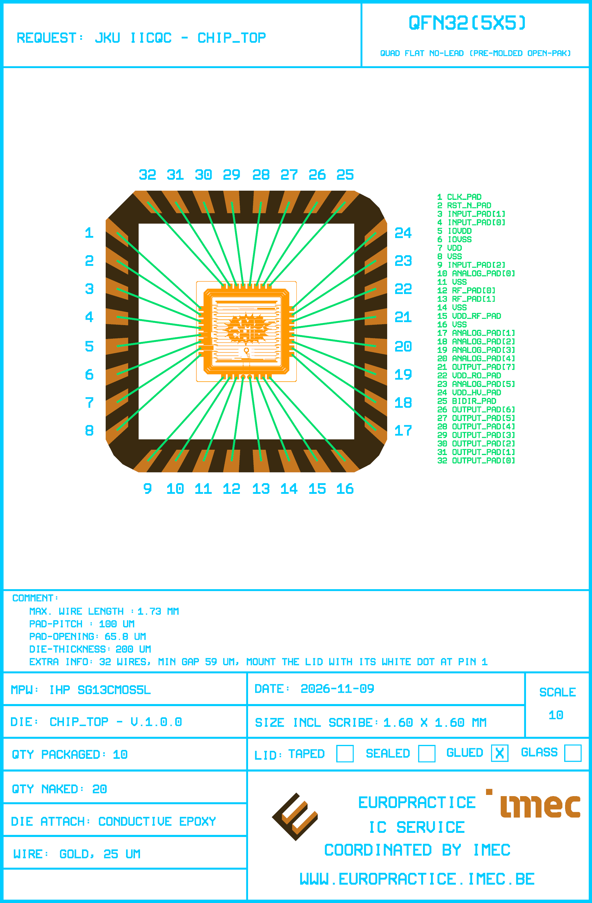

# Bondplan Report - chip_top v.1.0.0

Generated by `scripts/run_bondplan.py` on 2026-11-09.

## Summary

| | |
|---|---|
| Design | chip_top |
| Package | OP_QFN32_A4_FIT |
| Die size | 1.60 x 1.60 mm |
| Pad pitch / opening | 100 / 65.8 um |
| Bondwires | 32 (32 to leads, 0 exposed-pad downbonds) |
| Wire width | 25 um |
| Wire length | 1297 .. 1733 um |
| Min wire-to-wire gap | 59 um |
| Max lead skew | 4.8 deg |

## Bond Table

| Pin | Die pad | Die x/y (um) | Package x/y (um) | Length (um) | Angle (deg) | Skew (deg) | Min gap (um) |
|---|---|---|---|---|---|---|---|
| 1 | clk_PAD | 4045.0 / 9559.7 | 2760.0 / 10722.9 | 1733.2 | 137.8 | 4.8 | 58.9 |
| 2 | rst_n_PAD | 4045.0 / 9459.7 | 2760.0 / 10294.5 | 1532.3 | 147.0 | 4.3 | 58.9 |
| 3 | input_PAD[1] | 4045.0 / 9359.7 | 2760.0 / 9864.7 | 1380.7 | 158.5 | 3.1 | 68.1 |
| 4 | input_PAD[0] | 4045.0 / 9259.7 | 2760.0 / 9435.0 | 1296.9 | 172.2 | 1.3 | 74.1 |
| 5 | IOVDD | 4045.0 / 9159.7 | 2760.0 / 8984.5 | 1296.9 | -172.2 | 1.3 | 74.1 |
| 6 | IOVSS | 4045.0 / 9059.7 | 2760.0 / 8554.8 | 1380.7 | -158.5 | 3.1 | 68.1 |
| 7 | VDD | 4045.0 / 8959.7 | 2760.0 / 8125.1 | 1532.3 | -147.0 | 4.3 | 58.9 |
| 8 | VSS | 4045.0 / 8859.7 | 2760.0 / 7699.1 | 1731.6 | -137.9 | 4.7 | 58.9 |
| 9 | input_PAD[2] | 4390.0 / 8514.7 | 3229.3 / 7229.7 | 1731.6 | -132.1 | 4.7 | 58.9 |
| 10 | analog_PAD[0] | 4490.0 / 8514.7 | 3655.3 / 7229.7 | 1532.3 | -123.0 | 4.3 | 58.9 |
| 11 | VSS | 4590.0 / 8514.7 | 4085.0 / 7229.7 | 1380.7 | -111.5 | 3.1 | 68.1 |
| 12 | rf_PAD[0] | 4690.0 / 8514.8 | 4514.7 / 7229.7 | 1296.9 | -97.8 | 1.3 | 74.1 |
| 13 | rf_PAD[1] | 4790.0 / 8514.8 | 4965.3 / 7229.7 | 1296.9 | -82.2 | 1.3 | 74.1 |
| 14 | VSS | 4890.0 / 8514.7 | 5395.0 / 7229.7 | 1380.7 | -68.5 | 3.1 | 68.1 |
| 15 | vdd_rf_PAD | 4990.0 / 8514.7 | 5824.7 / 7229.7 | 1532.3 | -57.0 | 4.3 | 58.9 |
| 16 | VSS | 5090.0 / 8514.7 | 6250.6 / 7229.7 | 1731.5 | -47.9 | 4.7 | 58.9 |
| 17 | analog_PAD[1] | 5435.0 / 8859.7 | 6720.0 / 7699.1 | 1731.5 | -42.1 | 4.7 | 58.9 |
| 18 | analog_PAD[2] | 5435.0 / 8959.7 | 6720.0 / 8125.1 | 1532.3 | -33.0 | 4.3 | 58.9 |
| 19 | analog_PAD[3] | 5435.0 / 9059.7 | 6720.0 / 8554.8 | 1380.7 | -21.5 | 3.1 | 68.1 |
| 20 | analog_PAD[4] | 5435.0 / 9159.7 | 6720.0 / 8984.5 | 1296.9 | -7.8 | 1.3 | 74.1 |
| 21 | output_PAD[7] | 5435.0 / 9259.7 | 6720.0 / 9435.0 | 1296.9 | 7.8 | 1.3 | 74.1 |
| 22 | vdd_ro_PAD | 5435.0 / 9359.7 | 6720.0 / 9864.7 | 1380.7 | 21.5 | 3.1 | 68.1 |
| 23 | analog_PAD[5] | 5435.0 / 9459.7 | 6720.0 / 10294.5 | 1532.3 | 33.0 | 4.3 | 58.9 |
| 24 | vdd_hv_PAD | 5435.0 / 9559.7 | 6720.0 / 10720.4 | 1731.6 | 42.1 | 4.7 | 58.9 |
| 25 | bidir_PAD | 5090.0 / 9904.7 | 6250.6 / 11189.7 | 1731.6 | 47.9 | 4.7 | 58.9 |
| 26 | output_PAD[6] | 4990.0 / 9904.7 | 5824.7 / 11189.7 | 1532.3 | 57.0 | 4.3 | 58.9 |
| 27 | output_PAD[5] | 4890.0 / 9904.7 | 5395.0 / 11189.7 | 1380.7 | 68.5 | 3.1 | 68.1 |
| 28 | output_PAD[4] | 4790.0 / 9904.7 | 4965.3 / 11189.7 | 1296.9 | 82.2 | 1.3 | 74.1 |
| 29 | output_PAD[3] | 4690.0 / 9904.7 | 4514.7 / 11189.7 | 1296.9 | 97.8 | 1.3 | 74.1 |
| 30 | output_PAD[2] | 4590.0 / 9904.7 | 4085.0 / 11189.7 | 1380.7 | 111.5 | 3.1 | 68.1 |
| 31 | output_PAD[1] | 4490.0 / 9904.7 | 3655.3 / 11189.7 | 1532.3 | 123.0 | 4.3 | 58.9 |
| 32 | output_PAD[0] | 4390.0 / 9904.7 | 3226.8 / 11189.7 | 1733.2 | 132.2 | 4.8 | 58.9 |
