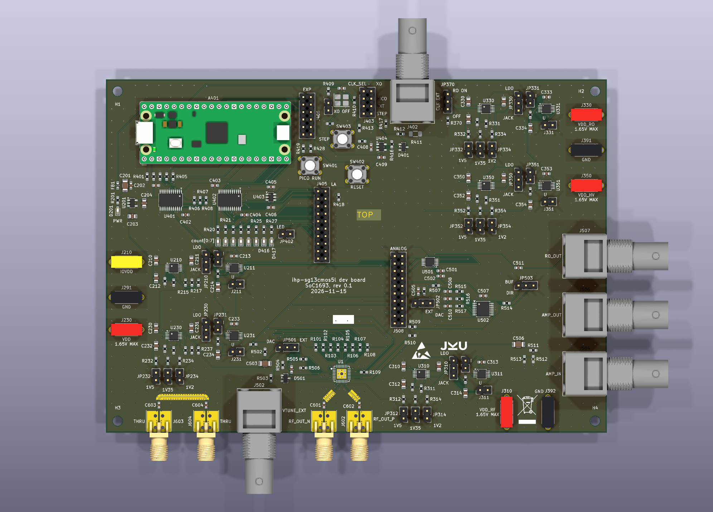
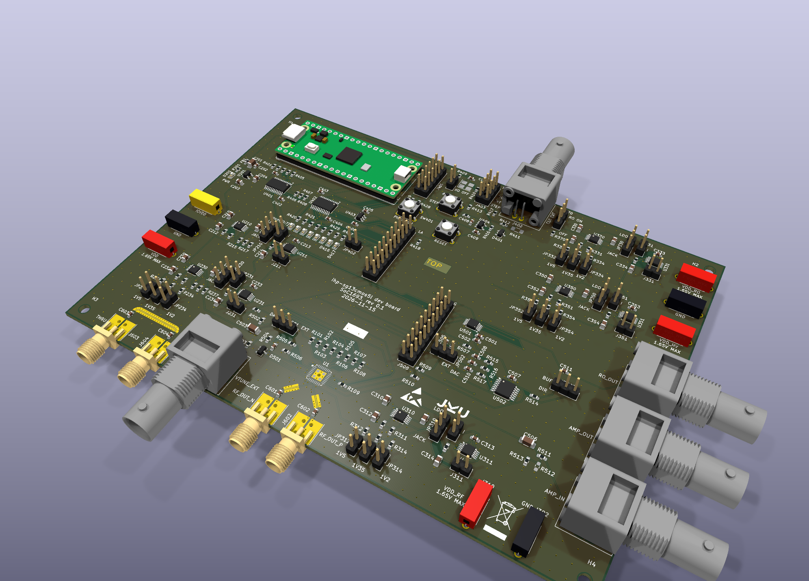
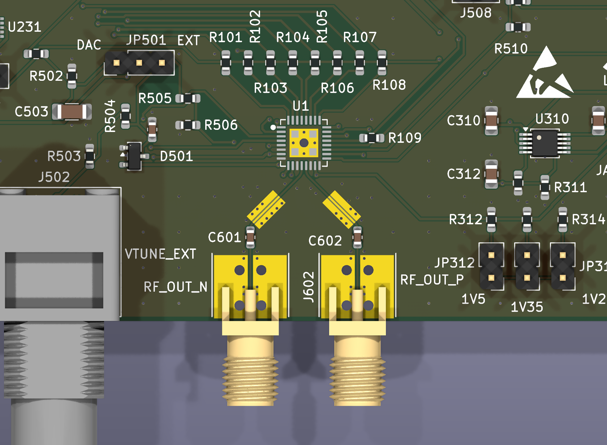
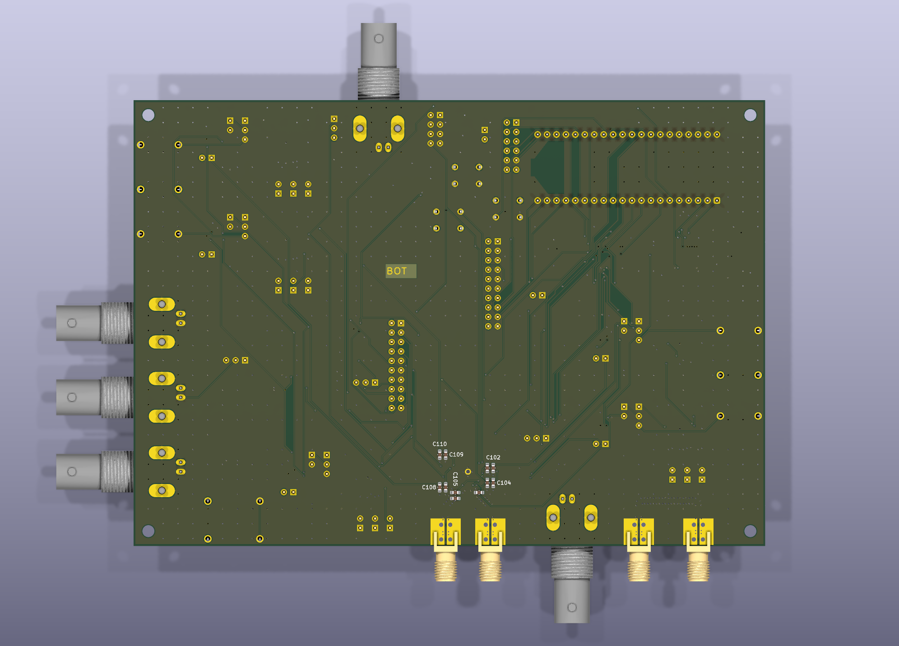

# IHP SG13CMOS5L dev board

KiCad 10 project of the development and test board of the chip taped out from branch `IHP-TO-2026-11` (IHP submission SoC1693), in its EUROPRACTICE QFN32 Open-Pak.
The board is made for hand soldering: passives are 0603 or larger, the ICs are leaded, the chip's lands reach 0.55 mm beyond its body, and its exposed pad is soldered from the bottom through a plated hole.
A Raspberry Pi Pico H on sockets is the host, with the GPIO map of the Tiny Tapeout demo board firmware. Every chip supply has its own LDO, a bench jack, a current jumper and an INA226, the analog pins come out on BNC and on a header, and the two VCO outputs on SMA.

<p align="center">
  
  
</p>
<p align="center">
  
  
</p>

## Files

| File | Contents |
| --- | --- |
| `ihp-sg13cmos5l_dev_board.kicad_pro` | Project: net classes (`RF_50`, `Power`, `Default`), design rules, track and via presets |
| `ihp-sg13cmos5l_dev_board.kicad_sch` | Root sheet: the chip, its decoupling, the series resistors of the outputs, mechanics |
| `power.kicad_sch` | USB input, 3.3 V auxiliary rail, `IOVDD` and `VDD` domains |
| `macros.kicad_sch` | `VDD_RF`, `VDD_RO` and `VDD_HV` domains, ring oscillator on/off |
| `host.kicad_sch` | Pico, level translators, clock sources and select, reset, count LEDs, headers |
| `analog.kicad_sch` | DAC, `vtune`, amplifier, inverter and ring oscillator front ends, buffers to the Pico ADC |
| `rf.kicad_sch` | VCO outputs and the reference line |
| `ihp-sg13cmos5l_dev_board.kicad_pcb` | Board, revision 0.1 |
| `ihp-sg13cmos5l_dev_board.kicad_dru` | Custom rules: the stricter value of JLCPCB and Aisler per rule, house rules, RF line and launch rules |
| `lib/` | Project symbols (chip, Pico H, TLV3544, ECS-3225MV) and footprints (QFN32 for hand soldering, Cinch SMA, Pico sockets, BNC with its silkscreen inside the board edge, tip jacks, logos), 3D models of the tip jacks |
| `render/` | Renders of the board |

Stock parts use the KiCad 10 libraries, and their 3D models resolve through `${KICAD10_3DMODEL_DIR}`. The Cinch SMA has no model there, so its footprint shows the Samtec edge-mount SMA instead. Every part carries `Manufacturer` and `MPN` fields.

## The chip on the board

The pin map is `packaging/config.yaml` of `ihp-sg13cmos5l-ams-chip-template @ 7bd9690` (branch `IHP-TO-2026-11`): pins 1 to 8 down the left side, 9 to 16 left to right along the bottom, 17 to 24 up the right side, 25 to 32 right to left along the top. The symbol `SoC1693` draws the pins where the package has them.

| Side | Pins | Board nets |
| --- | --- | --- |
| Left | 1 to 8 | `CLK`, `RST_N`, `SEL1`, `SEL0`, `IOVDD`, GND, `VDD`, GND |
| Bottom | 9 to 16 | `DI_EN`, `VTUNE`, GND, `RF_OUT_N`, `RF_OUT_P`, GND, `VDD_RF`, GND |
| Right | 17 to 24 | `AMP_VIN`, `AMP_VOUT`, `INV_VIN`, `INV_VOUT`, `inv_dout` (33 Ω series), `VDD_RO`, `RO_VOUT`, `VDD_HV` |
| Top | 25 to 32 | `count[7]` down to `count[0]`, each through a 33 Ω series resistor |

The footprint follows QP Technologies' `QP-QFN32-5MM-0.50MM` (drawing 500384 rev A), the part EUROPRACTICE's Open-Pak QFN32 matches: 5 × 5 mm body, 0.5 mm pitch, terminals 0.23 × 0.32 mm, exposed pad 3.2 mm. The lands are 0.25 mm wide and run from 2.05 to 3.05 mm from the centre, 0.55 mm beyond the body for the iron. The exposed pad is GND (conductive die attach on the substrate) and carries a 1.0 mm plated hole, so it can be soldered from the bottom side.

`di_en`, `vtune` and `vdd_rf` sit between the RF pins and the corners, so each leaves through a via right at its pin. The chip's decoupling (100 nF and 100 pF per supply pin, 10 nF on `vtune`) sits on the bottom side under its pins, the 10 µF of each domain after its shunt.

## Supplies

Power comes from the Pico's USB (`VBUS`) through a ferrite. An AP2112K makes 3.3 V for the board logic (translators, DAC, INA226, buffers, LEDs). Each chip domain has its own LT3042:

| Domain | Pin | Default | Set points | Shunt | INA226 | Jack |
| --- | --- | --- | --- | --- | --- | --- |
| `IOVDD` | 5 | 3.32 V | fixed | 4.7 Ω | 0x40 | yellow |
| `VDD` | 7 | 1.2 V | 1.5, 1.35, 1.2 V, 1.65 V open | 10 Ω | 0x41 | red |
| `VDD_RF` | 15 | 1.5 V | 1.5, 1.35, 1.2 V, 1.65 V open | 1 Ω | 0x44 | red |
| `VDD_RO` | 22 | 1.2 V | 1.5, 1.35, 1.2 V, 1.65 V open, off | 4.7 Ω | 0x45 | red |
| `VDD_HV` | 24 | 1.2 V | 1.5, 1.35, 1.2 V, 1.65 V open | 10 Ω | 0x42 | red |

- **Set points.** The base `R_SET` (16.5 kΩ, 100 µA from the SET pin) gives 1.65 V, the highest any of these pins may see. Each set-point jumper adds a resistor in parallel (165 kΩ, 75 kΩ and 44.2 kΩ for 1.5, 1.35 and 1.2 V), so a missing or moved jumper can only lower a rail.
- **Current limit.** 2.49 kΩ on `ILIM` limits every domain to 50 mA.
- **Order.** The chip's specification asks for `IOVDD` first and the ring `VDD` no later than `vdd_rf`. The enables are chained by power good: `IOVDD` (power good at 3.03 V) enables `VDD`, `VDD` (power good at 1.0 V) enables `VDD_RF`, `VDD_RO` and `VDD_HV`. The last three tie `PGFB` to their input, which disables power good and the fast start-up.
- **Source jumper** (1-2 fitted): 1-2 takes the LT3042, 2-3 the tip jack. A bench supply on a jack bypasses the power-up order and the current limit: bring `IOVDD` up first by hand, and keep the red jacks at or below 1.65 V.
- **Current jumper** (fitted): remove it for an ammeter. The INA226 reads the shunt behind it and the rail voltage at the chip side, over I2C.
- **`IOVDD_SRC`.** The translators' `IOVDD` side, the oscillator and the pull-ups take their supply ahead of the `IOVDD` current jumper, so the `IOVDD` reading is the chip alone.
- **Ring oscillator** (`JP370`): 1-2 on, 2-3 off (`VDD_RO` at 0 V, since the ring oscillator has no enable of its own).
- Every domain has a 2-pin voltage header (signal and GND).

## Host

A Raspberry Pi Pico H (RP2040) plugs into two 1x20 sockets, USB towards the left edge. Its GPIO use follows `GPIOMapTT06` of the Tiny Tapeout MicroPython firmware v2.x, so clock, reset, `ui_in` and `uo_out` sit where that SDK expects them (the TT project mux on GP2 to GP4 has no counterpart here):

| GPIO | TT name | Board use |
| --- | --- | --- |
| GP0 | `RP_PROJCLK` | `clk` (through the translator to `CLK_SEL` 3-4) |
| GP1 | `PROJECT_nRST` | `rst_n` |
| GP9, GP10, GP11 | `ui_in[0..2]` | `sel[0]`, `sel[1]`, `di_en` |
| GP5 to GP8, GP13 to GP16 | `uo_out[0..7]` | `count[0]` to `count[7]` |
| GP21 | `uio[0]` | `inv_dout` |
| GP18, GP19 | | I2C1 SDA, SCL (five INA226, MCP4728 at 0x60) |
| GP26, GP27, GP28 | | ADC: buffered `amp_vout`, `inv_vout` and `vtune` |
| GP2 to GP4, GP12, GP17, GP20, GP22 | | spare, on the `EXP` header `J406` |

- SN74LVC8T245 and SN74LVC1T45 translate between the Pico's 3.3 V and `IOVDD`. They isolate (Ioff) when either side is off, so the chip is never back-powered and `IOVDD` can be swept.
- Without the Pico the pull resistors hold `rst_n` high, `sel = 00` (no counter clocked), `di_en` low (VCO off) and the clock low.
- The chip's `sel` may change only with `rst_n` low or the clock stopped, and a counter resets only while selected and clocked (`doc/specifications.md` of the TO branch).
- Buttons: `PICO RUN` resets the Pico, `RESET` pulls `rst_n` low, `STEP` gives one clock edge per press (selected on `CLK_SEL` 7-8).
- Slow-clock demo: eight green LEDs show `count[7:0]` from the 3.3 V side of the translator, and removing `JP402` switches them off.
- `LA` header `J405`: odd pins `count[0]` to `count[7]`, `inv_dout` (all 3.3 V side) and the chip clock through 100 Ω, even pins GND.

## Clock

`CLK_SEL` (`J403`) takes one jumper:

| Jumper | Source |
| --- | --- |
| 1-2 | 50 MHz oscillator ECS-3225MV (on `IOVDD_SRC`, stopped by fitting `JP401`) |
| 3-4 | Pico GP0 |
| 5-6 | BNC `CLK_EXT`: 100 Ω in series, clamped to GND and `IOVDD`, 49.9 Ω termination `R411` not fitted |
| 7-8 | `STEP` button, debounced (RC and 74LVC1G14) |

Each source has its own 33 Ω series resistor, and the chip input has 100 kΩ to GND.

## Analog

| Signal | Board path |
| --- | --- |
| `amp_vin` | BNC `AMP_IN`, 0 Ω series (`R511`, fit 1 kΩ with `R512` = 10 Ω for 1:101), 1 MΩ to GND, 10 µF AC coupling: the amplifier biases itself through its `rhigh` |
| `amp_vout` | TLV3544 buffer (2 pF input), 47 Ω, to BNC `AMP_OUT` with `JP503` on 1-2, or straight from the pin on 2-3, buffered to ADC0 |
| `inv_vin` | DAC channel D through 22 kΩ and 100 kΩ (at most 1.65 V) with `JP502` on 1-2, or the `IV_EXT` header pin on 2-3, 100 Ω series, 1 MΩ to GND so that an open jumper leaves no crossover current |
| `inv_vout` | TLV3544 buffer to the `ANALOG` header and ADC1 |
| `ro_vout` | 100 nF DC block to BNC `RO_OUT` |
| `vtune` | DAC channel A through 68 kΩ, 200 kΩ and 100 nF C0G (31 Hz, 1.53 V full scale) with `JP501` on 1-2, or BNC `VTUNE_EXT` on 2-3 (1 kΩ series, clamped to GND and `VDD_RF`), 100 Ω series, 10 MΩ to GND, 10 nF at the pin, buffered to ADC2 |

The low-pass on `vtune` keeps the DAC's noise off the varactors: at the VCO's tuning gain of up to 1.78 GHz/V, 10 nV/√Hz at 1 MHz offset alone would give about -99 dBc/Hz against the VCO's own -101.6 dBc/Hz, while the chip's own `padres` (about 590 Ω) adds 3 nV/√Hz.

`ANALOG` header `J508`: odd pins `amp_vin`, `amp_vout`, `inv_vin`, `inv_vout`, buffered `inv_vout`, `ro_vout`, `vtune`, `IV_EXT`, DAC B, DAC C, even pins GND.

## VCO outputs and reference line

The outputs are back-terminated with 50 Ω to `vdd_rf` on the chip and sit at about 1.35 V, so each passes an 0603 C0G DC block (10 pF) before its SMA.

- **Line.** Grounded coplanar waveguide on `F.Cu`, 0.21 mm wide with 0.15 mm gaps over `In1.Cu`, bent in arcs of 1 mm radius, mask open over the line and its gaps away from the chip's pins. A GND via fence runs on both sides at 0.8 mm pitch (a tenth of the guided wavelength at 20 GHz), 0.75 mm from the line centre, into the ground lands of the SMA and clear of its posts.
- **Impedance.** 50.1 Ω on the stackup in the board file, from our 2-D field solver (within 0.2 Ω of Hammerstad-Jensen on a microstrip). Other stackups are listed under Fabrication.
- **DC block.** `In1.Cu` is cut out under each 0603, so its pads see the plane on `In2.Cu` and add less capacitance. A lumped estimate puts the block at no extra loss with the cut-out and up to 3 dB more at 21.6 GHz without it.
- **Connector.** Cinch 142-0761-881, end launch, 26.5 GHz, four posts in plated holes, 0.25 mm pin. Its pads start 0.3 mm inside the edge (a board rule overrides the house 0.5 mm there), because the pin projects only 0.76 ±0.25 mm from the body.
- **Reference line.** `J603` to `J604`: the same launch, line, fence and DC block as one output, twice, with the length of two output paths (17.245 mm from the chip pin to the DC block, arcs included), so that half its loss is the board's share of a VCO measurement.
- **What to expect.** 20 GHz leaves the package through about 1.3 mm of bond wire and the package lead. A lumped estimate gives 5 to 14 dB from the chip pad to the board, plus about 1 dB per cm of line. The SMAs serve frequency, tuning range and phase noise, not absolute output power, which is an on-wafer measurement.

## Markings

- Layer marker: `TOP` (`F.Cu`) and `2` (`In1.Cu`) read from the top, `3` (`In2.Cu`) and `BOT` (`B.Cu`), mirrored, from the bottom. Each pair sits in rule areas that forbid only the pour, under a mask window 0.1 mm inside the area, so a delivered board shows its layer order.
- Labels beside every jack, jumper, header, button and coaxial connector, and the title with the revision and the date.
- Write-on field for the serial number: a filled 7.2 × 3.0 mm silkscreen rectangle.
- Logos as filled silkscreen polygons in board-only footprints (no symbol, not in the BOM or the position files): JKU, ESD, WEEE.
- References 1.0 mm high with 0.15 mm stroke, in two reading directions, never over exposed copper. A reference that finds no free spot beside its part is hidden on the silkscreen and stays on the fab layer.

## Assembly

- Everything is on the top side except the chip's decoupling (11 capacitors under the chip). Passives are 0603 or larger, the ICs leaded (SOT-23, MSOP, TSSOP), the connectors, buttons, jacks and headers through-hole.
- Solder the chip first: lands, then the exposed pad from the bottom through its 1.0 mm hole.
- The five LT3042 (MSOP-10 with exposed pad) are the only parts that need hot air or a hot plate: their exposed pad is the ground and heat path underneath the body.
- Not fitted by default: `R411` (49.9 Ω clock termination) and `R512` (attenuator shunt).
- Not in the schematic: two 1x20 sockets for the Pico (Sullins PPTC201LFBN-RC) and the jumper shunts, one per jumper position listed above plus one for `CLK_SEL`.

## Fabrication

The board fits both JLCPCB and Aisler on one rule set, so either fab can build it unchanged.

| Rule | Value |
| --- | --- |
| Track and space | 0.125 mm (the board routes 0.25 mm signal and 0.3 mm supply tracks with 0.15 mm space) |
| Vias | 0.25 to 0.45 mm drill, 0.1 mm ring, 0.45 mm diameter or more (the board uses 0.3 mm in 0.6 mm) |
| Plated through holes | 0.3 mm ring |
| Thermal reliefs | one spoke at least (KiCad default two): the GND pins of the headers sit between tracks, and every one also connects to the `In1.Cu` and `In2.Cu` planes |
| Hole to hole | 0.45 mm, via to via 0.3 mm |
| Hole to copper | 0.28 mm, via hole 0.25 mm |
| Copper to edge | 0.5 mm (house rule, fabs 0.3 mm), 0.3 mm at the SMA launch pads |
| Silkscreen text | 1.0 mm high, 0.15 mm stroke |

The board file carries Aisler's 4-layer stackup: 1.6 mm, ENIG, 35 µm copper, 0.138 mm prepreg (εr 4.3) between `F.Cu` and `In1.Cu`, 1.2 mm core. `In1.Cu` and `In2.Cu` are solid GND planes, `F.Cu` and `B.Cu` carry the tracks in GND pours, and stitching vias tie the four layers on a 4 mm grid, except under silkscreen text. The CPWG impedance depends on the outer prepreg:

| Stackup | CPWG 0.21 mm, gap 0.15 mm |
| --- | --- |
| Aisler 4-layer 1.6 mm | 50.1 Ω |
| JLCPCB `JLC04161H-3313` | 43.3 Ω |
| JLCPCB `JLC04161H-7628` (JLCPCB default) | 57.8 Ω, select 3313 instead |

Order ENIG at either fab, since the chip's lands are 0.25 mm wide at 0.5 mm pitch.

## Checks

ERC reports three warnings, all `pin_to_pin` on the unused A6 to A8 inputs of `U401`, which are tied to GND, a pin the Pico symbol drives as a power output. The schematic and the board agree (DRC with `--schematic-parity`), and DRC reports no errors and no unconnected items. Two warning classes are left on purpose:

- 140 `track_angle`: the house 45° rule at branch points, two entries per branch: 62 T-junctions and 8 vias where tracks of three or more branches meet. Every other corner turns by 45° at most, and the RF lines bend in arcs.
- 199 `solder_mask_bridge`: KiCad stops reporting a violation type after 199 items, so this number is a cap. All of them lie in the three open mask strips over the RF lines, which expose the line, its ground fence vias and the edge of the GND pour in one opening. The project sets this check to warning.

The tracks are routed with FreeRouting 1.9.0 around the fixed copper (RF lines, fences, chip escape stubs, GND fan-out) and then cleaned up: duplicate and dangling pieces removed, plain 90° corners cut to 45°, and the few connections it left open completed.

From the repo root:

```sh
mkdir -p build
kicad-cli sch erc --severity-all --format json -o build/pcb_erc.json pcb/ihp-sg13cmos5l_dev_board.kicad_sch
kicad-cli pcb drc --severity-all --schematic-parity --format json -o build/pcb_drc.json pcb/ihp-sg13cmos5l_dev_board.kicad_pcb
kicad-cli pcb render --quality high --use-board-stackup-colors -o build/board.png pcb/ihp-sg13cmos5l_dev_board.kicad_pcb
```

## Open points

- The RF path is not EM-simulated: launch, DC block and line are sized from the 2-D solver and lumped estimates, and the reference line measures their loss on the delivered board.
- The 10 pF 0603 C0G capacitor is not specified as a DC block at 20 GHz: the body's parallel resonances set its loss there, and the lumped estimate does not model them. Measure the reference line before trusting the output level, and keep a broadband DC block in mind for the same footprint.
- The QFN32 land pattern is derived from the package drawing, since QP Technologies publishes no land pattern. Check it against the first parts before assembling a batch.
- No firmware ships with the board: the Tiny Tapeout SDK needs a board configuration for this GPIO map, and drivers for the INA226 and the MCP4728.
- The sequence by power good and the set points are from the data sheets, not measured.
